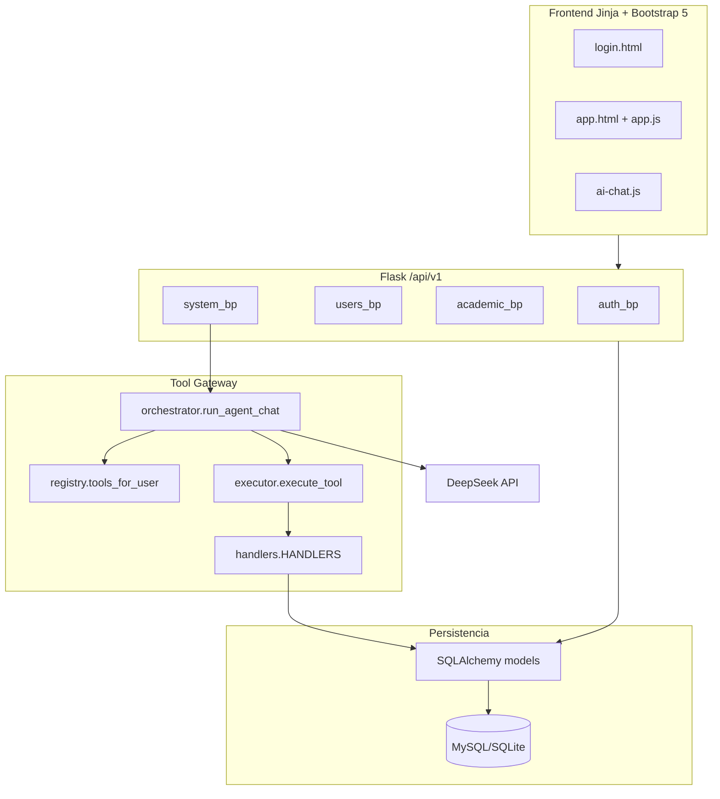
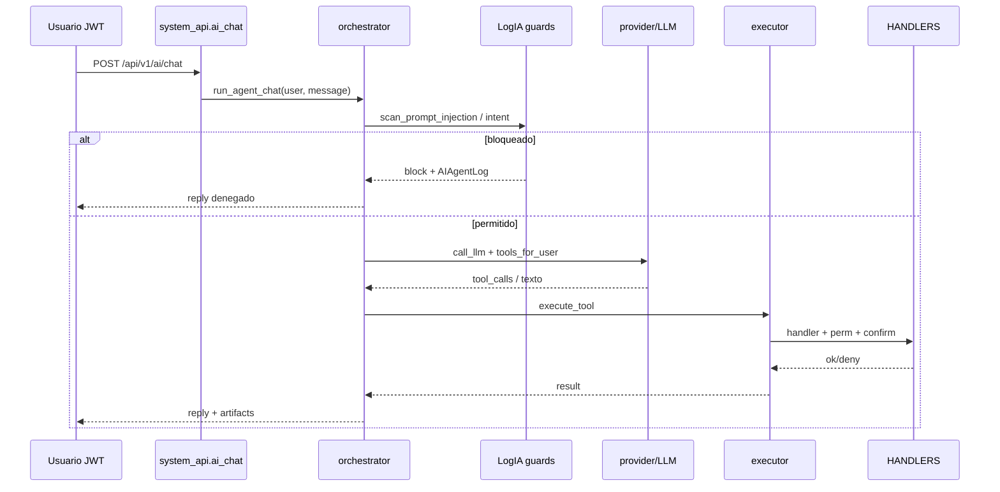

# Capítulo IV. Análisis, diseño e implementación

## 4.1 Visión general del artefacto

El repositorio `lab_ag_ia_g_edu` contiene dos árboles de aplicación paralelos:

- `laboratorioIA/App/`
- `laboratorioIB/App/`

Cada uno organiza `backend/` (Flask API), `frontend/` (templates Jinja + static JS/CSS) y `database/` (seeds, migrations vacías, SQLite opcional). Existen dumps SQL en la raíz de cada laboratorio (`laboratorioa.sql`, `laboratoriob.sql`). La documentación de investigación se aloja en `documentacion_investigacion/`.

## 4.2 Stack tecnológico

Según `requirements.txt` y el código de inicialización:

| Componente | Tecnología / versión declarada |
| --- | --- |
| Framework web | Flask 3.0.3 |
| ORM | Flask-SQLAlchemy 3.1.1 |
| Migraciones (dependencia) | Flask-Migrate 4.0.7 (carpeta migrations vacía en la práctica) |
| Auth | Flask-JWT-Extended 4.6.0 |
| CORS | Flask-Cors 4.0.1 |
| Rate limit | Flask-Limiter 3.8.0 |
| BD | PyMySQL 1.1.1 / SQLite vía `DATABASE_URL` |
| Crypto | cryptography 43.0.1 (AES para API key) |
| Hash passwords | Werkzeug generate/check_password_hash (+ bcrypt en requirements) |
| HTTP cliente LLM | requests 2.32.3 |
| Reportes | reportlab 4.2.5, openpyxl 3.1.5 |
| UI | Bootstrap 5 vía CDN en templates; JS en `frontend/static/js/` |
| Proveedor IA | DeepSeek (`DEEPSEEK_API_URL`, modelo configurable) |

La fábrica `create_app` en `app/__init__.py` registra blueprints `auth`, `users`, `academic`, `system`; aplica cabeceras de seguridad (SPEC-002); inicializa `db`, `jwt`, `limiter`, `migrate`; y expone rutas de frontend `/` y `/app/`.

## 4.3 Arquitectura lógica

## 4.4 Arquitectura del agente y controles

## 4.5 Requisitos funcionales implementados (evidencia)

| ID | Requisito | Evidencia principal | Estado |
| --- | --- | --- | --- |
| RF-01 | Autenticación login/refresh/logout | `auth/routes.py` | Implementado |
| RF-02 | RBAC roles/permisos | `models/iam.py`, `seed_data.py`, decorators | Implementado |
| RF-03 | CRUD académico | `api/academic.py`, models academic | Implementado |
| RF-04 | Notas con reglas >=7 y supletorio | `Grade.compute`, `services/grades.py` | Implementado |
| RF-05 | Asistencia y umbral >25% | `services/attendance.py`, academic API | Implementado |
| RF-06 | Visibilidad por perfil | `services/visibility.py` | Implementado |
| RF-07 | Impersonación login-as | `api/users.py` | Implementado |
| RF-08 | Chat IA + conversaciones | `system_api`, `ai/conversations.py` | Implementado |
| RF-09 | Tool Gateway | `ai/gateway/*` | Implementado |
| RF-10 | Reportes PDF/XLSX | `services/reports.py`, openpyxl/reportlab | Implementado |
| RF-11 | LogIA agent logs | `AIAgentLog`, `ai_agent_log.py` | Implementado |
| RF-12 | Modo inseguro IA | `insecure_mode.py` (solo laboratorioIA) | Implementado en IA |
| RF-13 | Intent guard dedicado IB | `ai_intent_guard.py` | Implementado en IB |
| RF-14 | Elevación de privilegios vía tool | función + modelo; no en HANDLERS | Parcial |
| RF-15 | Spec folders versionadas | README las menciona | Ausente en disco |
| RF-16 | Migraciones Alembic pobladas | carpeta vacía | Ausente / no usado |
| RF-17 | PDP/PAP formales | — | No implementado |

## 4.6 Requisitos no funcionales observables

- Seguridad de transporte de sesión: JWT access/refresh; refresh persistido en `RefreshToken`.
- Cabeceras: `X-Frame-Options`, `X-Content-Type-Options`, `Referrer-Policy`, CSP, HSTS en no-debug.
- Rate limiting en login y chat (con exención condicionada en modo inseguro IA).
- Cifrado de API key DeepSeek en `AIConfig.api_key_encrypted`.
- Auditoría de eventos de dominio y de seguridad del agente.
- UI con tema claro/oscuro (`User.theme`) y chatbot flotante (CHANGELOG 1.1.0 / JS `ai-chat.js`).

## 4.7 Modelos de datos

### 4.7.1 IAM (`models/iam.py`)

- `User`: credenciales, estado, lockout, tema, relaciones a roles, student/teacher.
- `Role`, `Permission`, tablas `user_roles`, `role_permissions`.
- `User.has_permission`: ADMIN bypass; resto por conjunto de permisos agregados de roles.

### 4.7.2 Perfiles (`models/profiles.py`)

- `Student`, `Teacher` vinculados a `User` y, en estudiante, a `Career`.

### 4.7.3 Académico (`models/academic.py`)

- `Career`, `Subject`, `Curriculum`, `Term` (incluye `grades_closed`), `Course`, `Assignment`, `Enrollment`, `Schedule`, `Grade`, `Attendance`.
- `Grade`: campos `partial1`, `partial2`, `supplementary`, `final_grade`, `status`; método `compute()`: promedio de parciales; si promedio < 7 y hay supletorio, `final_grade = supplementary`; estado `aprobado` si `final_grade >= 7` else `reprobado`.
- `Attendance.status`: `presente`, `ausente`, `tardanza`, `justificada`.

### 4.7.4 Sistema (`models/system.py`)

- `Notification`, `AuditLog`, `SystemConfig`, `AIConfig`, `AILog` (legacy).

### 4.7.5 IA / elevación (`models/ai_chat.py`)

- `AIConversation`, `AIMessage`, `AIArtifact` (URL firmada SPEC-021), `AIAgentLog` (LogIA), `ElevationRequest`.

## 4.8 Reglas de negocio de notas y asistencia

`apply_grade_rules` valida notas en [1, 10], calcula promedio, solo permite supletorio si promedio < 7, y llama `grade.compute()`. La API académica y la tool `grades_upsert` respetan cierre de periodo (`term.grades_closed`) salvo ADMIN, y el alcance de cursos del docente.

`is_critical_absence` retorna verdadero si `absence_rate > 0.25`. Al crear asistencia, la API puede marcar `critical_absence` y auditar.

## 4.9 Visibilidad e impersonación

`owned_course_ids` y `visible_term_ids` restringen datos para `STUDENT`/`TEACHER`/`GUARDIAN`. Staff en `STAFF_BYPASS` no aplica ese filtro. `test_visibility.py` codifica expectativas: admin ve 4 términos; estudiante ve 2 activos (`2025-1`, `2025-2`) tras el seed coherente.

La impersonación (`POST /api/v1/users/<id>/login-as`) emite tokens con `impersonator_id`, permitiendo soporte administrativo. Es un control de alto privilegio; el smoke test verifica que admin puede impersonar.
