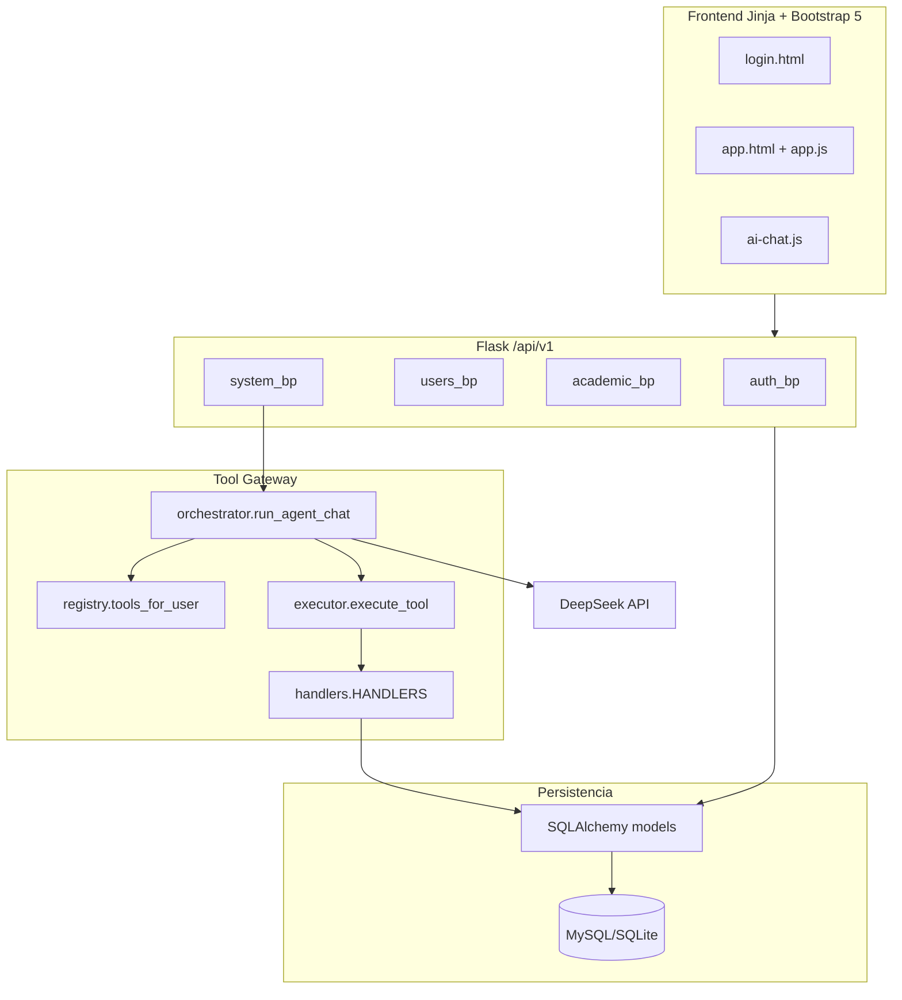
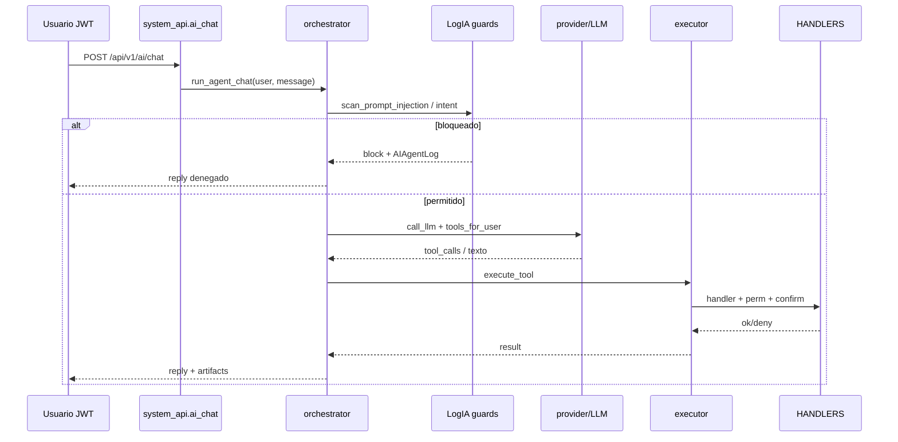

# Portada / datos del estudio

**Título:** Diseño e implementación de un laboratorio experimental de gestión educativa con agente de inteligencia artificial y control de acceso orientado a Zero Trust mediante Tool Gateway: comparación de escenarios laboratorioIA y laboratorioIB

**Tipo de documento:** Informe técnico de investigación aplicada (desarrollo experimental de laboratorio)

**Ámbito del artefacto de software:** Repositorio local `D:\\PROYECTOS\\lab_ag_ia_g_edu`, con dos aplicaciones Flask paralelas (`laboratorioIA` y `laboratorioIB`) bajo `App/backend`

**Enfoque metodológico:** Diseño e implementación de software + experimentación controlada en laboratorio (escenarios A/B), sin inferencia estadística poblacional

**Estilo de citación:** APA 7.ª edición

**Idioma:** Español académico, tercera persona

**Fecha de documentación del código:** octubre 2026

**Nota de fidelidad empírica:** El presente documento describe únicamente funcionalidades, módulos, rutas, modelos, scripts de prueba y diferencias observables en el código fuente del repositorio indicado. No se reportan porcentajes de éxito de pruebas, significancia estadística, encuestas a usuarios, despliegue productivo ni componentes formales PDP/PAP inexistentes en el código. Cuando el README o el CHANGELOG afirman la existencia de carpetas `/Spec` o `/Skill`, se indica explícitamente que dichas carpetas no se encuentran presentes en el árbol del repositorio inspeccionado.

---

# Resumen

El estudio documenta el diseño e implementación de un laboratorio experimental de gestión académica institucional que integra un agente de inteligencia artificial (IA) con herramientas (tools) mediatizadas por un *Tool Gateway*, bajo un control de acceso basado en roles y permisos (RBAC) y controles orientados a principios de Zero Trust. El artefacto consta de dos escenarios de laboratorio, `laboratorioIA` y `laboratorioIB`, implementados como aplicaciones Flask 3 con SQLAlchemy, autenticación JWT, limitación de tasa (*rate limiting*), interfaz Jinja/Bootstrap 5 y proveedor de lenguaje DeepSeek. Ambos escenarios comparten el dominio académico (carreras, materias, periodos, cursos, matrículas, calificaciones y asistencia), el catálogo de tools del gateway y la bitácora del agente (LogIA / `AIAgentLog`), pero difieren en el mecanismo experimental de relajación o refuerzo de guards: `laboratorioIA` incorpora el modo `AI_INSECURE_MODE` (`insecure_mode.py`, referenciado como SPEC-031 en comentarios de código), mientras que `laboratorioIB` enfatiza el módulo dedicado `ai_intent_guard.py` (SPEC-030) para denegar intenciones en lenguaje natural fuera de permiso. El análisis del código confirma la ausencia de módulos formales PDP/PAP, la ausencia de directorios `/Spec` y `/Skill` pese a su mención en README, y el carácter parcial de `privileges_request_elevation` (función existente pero no registrada en el diccionario `HANDLERS`). La evaluación disponible se limita a scripts de humo y validación (`test_smoke.py`, `test_visibility.py`, `test_mysql.py`, `validate_ai_chat.py`, `validate_dsml_parse.py`, `validate_filters_export.py`), cuyos resultados dependen del entorno local de ejecución y no se generalizan estadísticamente en este informe.

**Palabras clave:** Zero Trust, Tool Gateway, agente de inteligencia artificial, RBAC, gestión educativa, laboratorio experimental, prompt injection, Flask, DeepSeek.

---

# Abstract

This study documents the design and implementation of an experimental laboratory for institutional academic management that integrates an artificial intelligence (AI) agent with tool calling mediated by a Tool Gateway, under role- and permission-based access control (RBAC) and controls aligned with Zero Trust principles. The software artifact comprises two laboratory scenarios, laboratorioIA and laboratorioIB, implemented as Flask 3 applications with SQLAlchemy, JWT authentication, rate limiting, Jinja/Bootstrap 5 UI, and a DeepSeek language provider. Both scenarios share the academic domain model, the gateway tool catalog, and the agent audit log (LogIA / AIAgentLog), but differ in the experimental relaxation or reinforcement of guards: laboratorioIA includes AI_INSECURE_MODE (insecure_mode.py; SPEC-031 in code comments), whereas laboratorioIB emphasizes the dedicated ai_intent_guard.py module (SPEC-030) to deny natural-language intents outside the caller's permissions. Code inspection confirms the absence of formal PDP/PAP modules, the absence of /Spec and /Skill directories despite README claims, and the partial status of privileges_request_elevation (implemented as a function but not registered in HANDLERS). Available evaluation is limited to smoke and validation scripts whose outcomes depend on the local execution environment and are not statistically generalized in this report.

**Keywords:** Zero Trust, Tool Gateway, AI agent, RBAC, educational management, experimental laboratory, prompt injection, Flask, DeepSeek.

---

# Índice

1. Capítulo I. El problema de investigación
2. Capítulo II. Marco teórico y conceptual
3. Capítulo III. Metodología
4. Capítulo IV. Análisis, diseño e implementación
5. Capítulo V. Pruebas, resultados y discusión
6. Capítulo VI. Conclusiones y trabajo futuro
7. Referencias
8. Anexos
   - Anexo A. Estructura de directorios
   - Anexo B. Catálogo de endpoints (resumen)
   - Anexo C. Catálogo de tools del gateway
   - Anexo D. Variables de entorno (nombres)
   - Anexo E. Diferencias laboratorioIA vs laboratorioIB

---


# Capítulo I. El problema de investigación

## 1.1 Antecedentes

La digitalización de la gestión académica ha consolidado sistemas institucionales capaces de administrar identidades, roles, matrículas, calificaciones y asistencia. En paralelo, la adopción de asistentes basados en modelos de lenguaje introduce un canal de interacción no determinista: el usuario expresa intenciones en lenguaje natural y el sistema debe traducirlas a operaciones sobre datos sensibles. Esta convergencia genera una tensión operativa entre usabilidad y control de acceso. Rose et al. (2020) formalizan Zero Trust Architecture (ZTA) como un enfoque en el que ninguna solicitud se considera intrínsecamente confiable por su ubicación o por una autenticación inicial, sino que cada acceso se evalúa con identidad, política y contexto. En el ámbito de la ciberseguridad educativa y de los sistemas de información, Syed et al. (2022) y Buck et al. (2021) sitúan Zero Trust como respuesta a modelos perimetrales insuficientes cuando los actores, dispositivos y APIs se multiplican.

Los agentes con herramientas (tool-using agents) amplifican el problema: el modelo no solo responde texto, sino que puede invocar funciones que leen o mutan el estado del sistema. Kang et al. (2023) y Azad et al. (2024) evidencian la relevancia de superficies de ataque asociadas a inyección de instrucciones y a la mala alineación entre intención del usuario y privilegios reales. Deng et al. (2025) sintetizan líneas de defensa para agentes, mientras que Jeong y Yang (2025) y Xu et al. (2025) discuten controles prácticos en entornos aplicados. En educación, Adahman et al. (2022) y Awan et al. (2023) subrayan la sensibilidad de datos académicos y la necesidad de gobernanza; Vasović et al. (2026), Mawgoud et al. (2025), Kanaker et al. (2026), Gulyamov et al. (2026) y Geng et al. (2026) aportan marcos contemporáneos sobre confianza, privacidad y arquitecturas de control en sistemas conectados. Shostack (2014) ofrece una base metodológica de modelado de amenazas que permite razonar sobre activos, actores y controles sin presuponer métricas de campo no medidas.

El repositorio lab_ag_ia_g_edu materializa esta problemática en un laboratorio reproducible: dos aplicaciones Flask (laboratorioIA y laboratorioIB) con dominio académico completo, RBAC granular, agente DeepSeek y un Tool Gateway que filtra tools según permisos, exige confirmación en mutaciones (salvo modo inseguro) y registra bloqueos en LogIA y auditoría. El presente capítulo formula el problema a partir de esa evidencia de software, no a partir de un despliegue productivo inexistente en el artefacto documentado.

## 1.2 Planteamiento del problema

En sistemas de gestión educativa con agente conversacional, el riesgo no se limita a la autenticación fallida. Un usuario autenticado con rol restringido (por ejemplo, TEACHER o STUDENT) puede formular en lenguaje natural solicitudes que exceden su ámbito: listados institucionales de usuarios, exportación masiva de estudiantes, consulta de auditoría o asignación de roles. Si el agente dispone de tools poderosas y el orquestador no intermedia la invocación con comprobaciones de permiso, confirmación y registro, se rompe el principio de mínimo privilegio. Rose et al. (2020) enfatizan la evaluación continua de acceso; Syed et al. (2022) y Buck et al. (2021) advierten que la confianza implícita post-login es un anti-patrón. Kang et al. (2023) y Azad et al. (2024) muestran que la inyección de prompts puede intentar redefinir políticas del asistente. Deng et al. (2025) y Jeong y Yang (2025) destacan que la defensa debe combinar filtrado de entrada, restricción de herramientas y telemetría.

El problema práctico del laboratorio es, por tanto, doble: (a) construir un sistema académico funcional con IAM, reglas de notas/asistencia, reportes y chat con tools; y (b) comparar escenarios de control del agente (IA vs IB) que permitan observar, en condiciones de laboratorio, cómo se endurecen o relajan los guards sin inventar una arquitectura Zero Trust completa con PDP/PAP formales. El código implementa controles orientados a Zero Trust (chequeo por tool, logging zero_trust/least_privilege en bloqueos, denegación de intentos NL), pero no implementa Policy Decision Point ni Policy Administration Point como módulos nombrados. Declarar lo contrario sería una distorsión empírica.

## 1.3 Formulación del problema

¿Cómo diseñar e implementar un laboratorio experimental de gestión educativa con agente de IA y Tool Gateway, de modo que el control de acceso RBAC y los guards del agente (incluyendo diferencias entre laboratorioIA y laboratorioIB) operen de forma verificable en código, alineados con principios de Zero Trust, sin afirmar componentes o resultados que no existan en el repositorio?

## 1.4 Preguntas de investigación

1. ¿Qué arquitectura de software y qué modelos de dominio académico e IAM existen efectivamente en laboratorioIA y laboratorioIB?
2. ¿Cómo el Tool Gateway (
egistry, executor, handlers, orchestrator) restringe tools, mutaciones y registro de bloqueos?
3. ¿En qué difieren los escenarios IA (modo AI_INSECURE_MODE) e IB (módulo i_intent_guard) respecto a guards del agente?
4. ¿Qué evidencia de verificación aportan los scripts de humo y validación existentes, y cuáles son sus límites?
5. ¿Qué elementos quedan parciales o ausentes (elevación de privilegios en HANDLERS, carpetas Spec/Skill, migraciones Alembic pobladas, PDP/PAP)?

## 1.5 Justificación

La justificación es técnica y académica. Técnicamente, el laboratorio ofrece un entorno controlado para estudiar el acoplamiento entre RBAC clásico (decoradores y permisos modulo.accion) y un canal de agente que puede saltarse la UI. Académicamente, permite contrastar literatura de Zero Trust y agentes (Rose et al., 2020; Syed et al., 2022; Buck et al., 2021; Kang et al., 2023; Azad et al., 2024; Deng et al., 2025; Jeong & Yang, 2025; Xu et al., 2025) con una implementación concreta y auditable. En el contexto educativo, la exposición de calificaciones, asistencia y directorios de usuarios exige controles explícitos (Adahman et al., 2022; Awan et al., 2023). El valor del estudio no reside en afirmar madurez productiva, sino en documentar con precisión qué está implementado, qué es parcial y qué queda como trabajo futuro, en la línea de transparencia metodológica que Shostack (2014) asocia al modelado de amenazas honesto.

## 1.6 Objetivo general

Diseñar, implementar y documentar un laboratorio experimental de gestión educativa con agente de IA y Tool Gateway, comparando los escenarios laboratorioIA y laboratorioIB en cuanto a controles de acceso y guards orientados a Zero Trust, con base exclusiva en evidencia del código fuente.

## 1.7 Objetivos específicos

1. Describir la arquitectura Flask, el stack tecnológico y los modelos de datos académicos e IAM presentes en ambas aplicaciones.
2. Caracterizar el Tool Gateway: registro de schemas, filtrado por permisos, ejecución con confirmación, handlers y orquestación del chat.
3. Analizar los mecanismos de seguridad del agente (heurísticas de inyección, LogIA, intent guard, modo inseguro) y su mapeo a comentarios SPEC-016…SPEC-031 en el código.
4. Comparar sistemáticamente diferencias observables entre laboratorioIA y laboratorioIB.
5. Documentar la batería de scripts de prueba/validación sin inventar tasas de éxito, e identificar limitaciones y trabajo futuro (incluyendo el cableado de privileges_request_elevation al diccionario HANDLERS).

## 1.8 Alcance

El alcance incluye: (a) inspección y documentación de laboratorioIA/App y laboratorioIB/App; (b) API REST bajo /api/v1; (c) dominio académico y reglas de negocio de notas y asistencia; (d) Tool Gateway y servicios de IA; (e) seeds y dumps SQL (laboratorioa.sql, laboratoriob.sql); (f) scripts de prueba en ackend/. El alcance excluye: despliegue en producción, evaluación con usuarios reales, análisis estadístico inferencial, implementación de PDP/PAP formales no presentes, y reconstrucción de especificaciones Spec-as-Skill ausentes como carpetas en el repositorio.

## 1.9 Limitaciones

Las limitaciones principales son: (1) los README afirman metodología Spec as Skill con rutas /Spec y /Skill, pero esas carpetas no existen en el árbol inspeccionado; (2) database/migrations está vacío y el esquema se crea vía db.create_all() y dumps SQL; (3) no hay PDP/PAP como componentes formales; (4) privileges_request_elevation existe como función y modelo ElevationRequest, pero no está en HANDLERS, por lo que el LLM no puede invocarla como tool registrada; (5) la evaluación es de laboratorio y dependiente del entorno (BD sembrada, API key DeepSeek, variables .env); (6) no se reportan métricas de efectividad de bloqueos ni significancia estadística porque no forman parte de los artefactos de prueba del repositorio.

## 1.10 Hipótesis de trabajo (no estadística)

Se formula como hipótesis de diseño, no como hipótesis estadística a contrastar con p-valores: un Tool Gateway que filtre tools por permiso, confirme mutaciones, registre bloqueos en LogIA/auditoría y aplique guards de inyección e intención reduce la superficie de acciones no autorizadas del agente respecto de un modo deliberadamente inseguro, en el marco de un laboratorio controlado. La verificación se realiza por inspección de código y scripts deterministas locales, no por inferencia poblacional.

## 1.11 Relevancia para la ciberseguridad educativa

Los datos académicos concentran información personal y de rendimiento. Un agente que pueda llamar users_assign_roles, grades_upsert o 
eports_generate sin mediación adecuada concentra riesgo de abuso interno y de manipulación por prompt. Vasović et al. (2026) y Mawgoud et al. (2025) insisten en controles aplicados; Kanaker et al. (2026) y Gulyamov et al. (2026) refuerzan la necesidad de arquitecturas explicables y auditables; Geng et al. (2026) aportan perspectivas de control en sistemas conectados. El laboratorio permite ensayar estas preocupaciones en un sistema completo pero no productivo, con datos sintéticos de seeds (seed_coherent, seed_massive, seed_data).

## 1.12 Delimitación operativa de Zero Trust en este estudio

En este documento, “orientado a Zero Trust” significa: autenticación JWT previa al uso del agente; autorización por permiso en cada tool; denegación por defecto de tools desconocidas; registro de bloqueos con marcas zero_trust y least_privilege en el detalle del executor; ausencia de confianza ciega en el texto del modelo. No significa equivalencia con una implementación completa de NIST SP 800-207 con PDP, PEP y PAP separados. Rose et al. (2020) proporcionan el marco conceptual; el software aporta un subconjunto práctico mediatizado por el gateway.


# Capítulo II. Marco teórico y conceptual

## 2.1 Propósito del marco

Este capítulo no pretende catalogar definiciones aisladas, sino situar el artefacto `lab_ag_ia_g_edu` en un estado del arte verificable: arquitectura Zero Trust, agentes con herramientas, inyección de instrucciones, control de acceso en sistemas educativos y la brecha entre marcos formales y laboratorios implementables. Las citas se limitan al conjunto de fuentes autorizadas para este documento.

## 2.2 Zero Trust: de la especificación a la práctica de laboratorio

Rose et al. (2020), en NIST SP 800-207, conceptualizan Zero Trust Architecture como un modelo en el que los recursos se protegen mediante autenticación y autorización continuas, con políticas que consideran identidad, dispositivo, atributos de recurso y contexto. El perímetro deja de ser el principal ancla de confianza. Syed et al. (2022) amplían la discusión hacia migraciones y retos de adopción, subrayando que Zero Trust es un programa de controles y gobernanza, no un producto único. Buck et al. (2021) analizan percepciones y barreras organizacionales, relevantes cuando un laboratorio académico pretende enseñar o ensayar controles sin disponer aún de una infraestructura empresarial completa.

En el software estudiado, la orientación a Zero Trust se observa en mecanismos concretos: JWT de corta duración configurable (`JWT_ACCESS_MINUTES`), bloqueo por intentos fallidos (`LOGIN_MAX_ATTEMPTS`, `LOGIN_LOCK_MINUTES`), permisos por acción, filtrado de tools visibles al LLM (`tools_for_user`), denegación de tools desconocidas, confirmación de mutaciones y doble registro LogIA/auditoría en bloqueos de privilegio. No se observa, en cambio, una separación formal de Policy Decision Point (PDP) y Policy Administration Point (PAP) como servicios o paquetes independientes. Afirmar que el laboratorio “implementa ZTA completa según NIST” excedería la evidencia; lo correcto es afirmar que implementa controles alineados con principios de ZTA en el canal del agente y en la API.

Kanaker et al. (2026) y Gulyamov et al. (2026) aportan discusiones recientes sobre computación confiable e información segura que refuerzan la pertinencia de laboratorios auditables. Geng et al. (2026) y Vasović et al. (2026) coinciden en la necesidad de controles aplicables en sistemas reales o semi-reales. Mawgoud et al. (2025) enfatizan aspectos de concurrencia y robustez que, en el laboratorio, se traducen en decisiones de diseño como rate limiting (`Flask-Limiter`) y transacciones SQLAlchemy en mutaciones de tools.

## 2.3 Agentes de IA con herramientas y Tool Gateway

Un agente con tools recibe del modelo propuestas de invocación de funciones y las ejecuta en el entorno. El riesgo central es la desalineación entre lo que el modelo “cree” poder hacer y lo que la política de la aplicación permite. Deng et al. (2025) revisan defensas para agentes; Jeong y Yang (2025) y Xu et al. (2025) discuten controles y privacidad en despliegues aplicados. El patrón Tool Gateway, tal como aparece en `app/ai/gateway/`, introduce una capa intermedia: el orquestador (`orchestrator.run_agent_chat`) obtiene schemas permitidos (`registry.tools_for_user`), llama al proveedor (`provider.call_llm`), parsea tool calls (incluyendo markup DSML, SPEC-023) y delega en `executor.execute_tool`, que consulta `HANDLERS`, verifica permisos y, si corresponde, exige confirmación.

Esta mediación es coherente con la idea de no confiar en el texto del modelo como autorización. Rose et al. (2020) insistirían en evaluar cada solicitud; aquí cada tool call es una solicitud de acceso a un recurso académico o de IAM. Syed et al. (2022) y Buck et al. (2021) ayudarían a interpretar el gateway como control técnico embebido en la aplicación, no como plano de control de red. Kang et al. (2023) y Azad et al. (2024) motivan por qué el gateway debe combinar allowlist de tools y logging: la superficie de ataque incluye tanto la invocación indebida como la manipulación del prompt.

## 2.4 Inyección de prompts, jailbreak y escalada narrativa

Kang et al. (2023) y Azad et al. (2024) documentan que los modelos pueden ser influenciados por instrucciones adversarias insertadas en el mensaje del usuario. En el laboratorio, `scan_prompt_injection` (servicio LogIA) aplica heurísticas por expresiones regulares antes de invocar al LLM, clasificando hallazgos como `prompt_injection`, `jailbreak` o `privilege_escalation`. Los bloqueos se registran con `log_security_block` y acciones de auditoría `AI_PROMPT_INJECTION_BLOCK` / `AI_POLICY_BLOCK`. Deng et al. (2025) situarían estas heurísticas como una línea de defensa de entrada, incompleta por sí sola pero útil en laboratorio. Jeong y Yang (2025) y Xu et al. (2025) subrayan la importancia de no depender solo del system prompt; el código del laboratorio refuerza esa idea al aplicar guards en el orquestador independientemente del prompt configurado en `AIConfig`.

Un matiz empírico relevante: en `laboratorioIA`, si `AI_INSECURE_MODE` está activo, `scan_prompt_injection` y `scan_unauthorized_intent` retornan `None`, y el executor omite chequeos de permiso y confirmación. El modo inseguro es, por diseño, un escenario de contraste experimental documentado en `.env.example` con advertencia de no usarlo en producción. En `laboratorioIB`, el módulo `ai_intent_guard.py` concentra reglas de intención NL (directorios de usuarios, roles, auditoría, docentes, exportación institucional de estudiantes), con excepciones de ámbito propio del docente (`_OWN_SCOPE_HINT`).

## 2.5 RBAC, mínimo privilegio y visibilidad de datos

El laboratorio implementa RBAC clásico: roles (`ADMIN`, `RECTOR`, `COORDINATOR`, `TEACHER`, `STUDENT`, `SECRETARY`, `REVIEWER`, `AUDITOR`, `GUARDIAN`, `IT_SUPPORT`) y permisos `modulo.accion` sembrados en `seed_data.py`. El usuario `ADMIN` tiene bypass en `has_permission`. Además, `visibility.py` introduce alcance por propiedad de cursos y periodos activos para roles restringidos (`STUDENT`, `TEACHER`, `GUARDIAN`), mientras un conjunto `STAFF_BYPASS` ve sin ese filtro. Esta doble capa (permiso + alcance) es central para el agente: una tool puede estar permitida por permiso (`students.view`) y aun así filtrar filas al ámbito del docente.

Adahman et al. (2022) y Awan et al. (2023) enmarcan la sensibilidad de datos educativos; el scoping evita que un docente vea estudiantes de otros cursos vía API o vía tool. Shostack (2014) sugeriría modelar amenazas de “confused deputy” cuando el agente actúa en nombre del usuario: el gateway mitiga parte del riesgo al ejecutar tools con el usuario autenticado y sus permisos, no con una identidad de servicio omnisciente.

## 2.6 Educación, gestión académica e IA

La gestión académica digitaliza flujos de matrícula, evaluación y asistencia. El laboratorio codifica reglas de negocio específicas: notas `partial1`/`partial2`/`supplementary`/`final_grade` con aprobación `>= 7.0` vía `Grade.compute` y `apply_grade_rules`; asistencia crítica si la tasa de `ausente` supera 0.25. Estas reglas son dominio educativo, no de ciberseguridad, pero condicionan qué mutaciones el agente puede realizar (`grades_upsert`, `attendance_upsert`) y qué reportes generar. Vasović et al. (2026) y Mawgoud et al. (2025) recuerdan que la confiabilidad del sistema educativo digital depende tanto de la lógica de negocio como de la seguridad. Kanaker et al. (2026), Gulyamov et al. (2026) y Geng et al. (2026) aportan contexto contemporáneo para justificar laboratorios que combinen ambos planos.

## 2.7 Modelado de amenazas aplicable al laboratorio

Siguiendo a Shostack (2014), se identifican activos (calificaciones, directorios, roles, API keys cifradas, logs), actores (estudiante, docente, administrador, atacante con cuenta legítima de bajo privilegio, modelo manipulado por prompt) y controles (JWT, RBAC, gateway, heuristics, LogIA, cabeceras HTTP, limiter). Amenazas ilustrativas: (T1) solicitar vía chat un reporte institucional sin permiso; (T2) inyección para ignorar políticas; (T3) mutación de notas sin confirmación; (T4) tool desconocida inventada por el modelo; (T5) exfiltración de API key (mitigada por AES y máscara en `AIConfig.to_dict`). El laboratorio implementa mitigaciones para T1–T4 en modo seguro; T3 se debilita deliberadamente bajo `AI_INSECURE_MODE` en IA.

## 2.8 Síntesis de la brecha

La brecha que este proyecto aborda no es la ausencia total de literatura sobre Zero Trust o agentes, sino la escasez de artefactos educativos abiertos que: (a) implementen un dominio académico realista; (b) expongan un agente con tools mediatizadas; (c) permitan comparar escenarios de hardening; y (d) documenten con honestidad qué falta (Spec folders, PDP/PAP, elevación cableada, migraciones). Rose et al. (2020), Syed et al. (2022) y Buck et al. (2021) describen el “qué” estratégico de Zero Trust; Kang et al. (2023), Azad et al. (2024), Deng et al. (2025), Jeong y Yang (2025) y Xu et al. (2025) describen riesgos y defensas de agentes; Adahman et al. (2022), Awan et al. (2023), Vasović et al. (2026), Mawgoud et al. (2025), Kanaker et al. (2026), Gulyamov et al. (2026) y Geng et al. (2026) anclan la criticidad sectorial. El laboratorio aporta el “cómo” implementable a escala de prototipo, sin confundir prototipo con producto.

## 2.9 Conceptos operativos usados en el resto del documento

Para evitar ambigüedad: (1) *Implementado* = presente en código y reachable por rutas o por `HANDLERS`; (2) *Parcial* = código existe pero no está integrado al flujo principal (caso `privileges_request_elevation`); (3) *Afirmado pero ausente* = mencionado en README/CHANGELOG sin carpeta o artefacto correspondiente (`/Spec`, `/Skill`); (4) *Futuro* = propuesta explícita de trabajo, no estado actual; (5) *Orientado a Zero Trust* = controles de verificación por solicitud en API/agente, sin equivalencia a ZTA formal completa.

## 2.10 Relación entre literatura y decisiones de diseño observables

La decisión de filtrar `TOOL_SCHEMAS` por permiso antes de enviarlos al LLM reduce la probabilidad de que el modelo proponga tools imposibles; Deng et al. (2025) recomendarían capas múltiples, y el laboratorio añade además el executor. La confirmación de mutaciones operacionaliza el principio de no ejecutar cambios de estado por una sola interpretación ambigua del lenguaje natural. El LogIA materializa la exigencia de telemetría que Rose et al. (2020) asocian a entornos Zero Trust. El cifrado AES de la API key y su no exposición al frontend responden a amenazas de compromiso de secretos en clientes web. La impersonación (`login-as`) existe para soporte administrativo, con claims `impersonator_id`; es un poder elevado que debe auditarse, coherente con la cautela de Buck et al. (2021) sobre privilegios operativos.

En conjunto, el marco teórico sostiene que el problema de investigación es legítimo, que las fuentes autorizadas bastan para anclar el discurso y que la contribución empírica del estudio es la documentación rigurosa de un laboratorio dual IA/IB, no la demostración estadística de superioridad de un escenario sobre otro.


# Capítulo III. Metodología

## 3.1 Enfoque general

El estudio adopta un enfoque de investigación aplicada basada en diseño e implementación de software, complementado con experimentación de laboratorio tipo A/B entre dos despliegues locales (`laboratorioIA` y `laboratorioIB`). No se trata de un ensayo clínico, ni de una encuesta, ni de un experimento aleatorizado con inferencia estadística. La unidad de análisis es el propio sistema de software y su comportamiento verificable mediante inspección de código y scripts de humo/validación.

## 3.2 Tipo de investigación

Se clasifica como investigación tecnológica / desarrollo experimental de laboratorio. El producto es un artefacto ejecutable y documentado. La comparación IA vs IB es cualitativa-estructural (presencia/ausencia de módulos y flags, diferencias de guards) y, cuando se ejecutan scripts, operacional (códigos HTTP, aserciones locales), sin reportar aquí tasas agregadas inventadas.

## 3.3 Población, muestra y datos

No hay población humana de estudio. Los datos son sintéticos generados por seeds (`seed_data.py`, `seed_coherent.py`, `seed_massive.py`) y dumps SQL (`laboratorioa.sql`, `laboratoriob.sql`). El README de `laboratorioIA` describe un dataset demo amplio (carreras, docentes, estudiantes, matrículas, asistencias) tras `seed_coherent`. El uso de datos sintéticos mitiga riesgos éticos de privacidad real (Adahman et al., 2022; Awan et al., 2023).

## 3.4 Procedimiento Spec-as-Skill: afirmación versus evidencia

Los README de ambas aplicaciones afirman: “Construido con metodología Spec as Skill (ver `/Spec` y `/Skill`)”. El CHANGELOG mapea acciones a identificadores `SPEC-001` … y skills asociados en las versiones 1.0.0 y 1.1.0. Además, comentarios en el código referencian SPEC-016 a SPEC-031 (gateway, conversaciones, reportes, LogIA, intent guard, modo inseguro, etc.).

**Hallazgo metodológico crítico:** al inspeccionar el repositorio, las carpetas `/Spec` y `/Skill` **no están presentes**. Por tanto, este estudio trata Spec-as-Skill como una metodología *reclamada* y parcialmente trazable vía CHANGELOG y comentarios, pero **no** como un cuerpo de especificaciones versionadas disponible en el árbol de directorios. Documentar lo contrario violaría la regla de fidelidad empírica.

## 3.5 Diseño de escenarios A/B

| Dimensión | laboratorioIA | laboratorioIB |
| --- | --- | --- |
| App Flask académica | Sí | Sí |
| Tool Gateway + HANDLERS | Sí | Sí |
| LogIA / injection heuristics | Sí | Sí |
| `insecure_mode.py` / `AI_INSECURE_MODE` | Sí (diferenciador) | No (archivo ausente) |
| `ai_intent_guard.py` dedicado | No (intent en `ai_agent_log.py`) | Sí (diferenciador) |
| Base demo / seeds | Sí | Sí (credenciales demo más reducidas en README IB) |

El diseño experimental consiste en mantener un núcleo funcional común y variar el régimen de guards del agente. En IA, el flag `AI_INSECURE_MODE` permite desactivar anti-injection, intent guard, chequeo de permisos en executor y confirmación de mutaciones. En IB, el énfasis documental y modular está en el guard de intención NL dedicado. Ambos permanecen laboratorios locales, no producción.

## 3.6 Técnicas de recolección de evidencia

1. **Inspección estática del código:** modelos, APIs, gateway, servicios, configuración, seeds.
2. **Inspección de estructura de directorios:** verificación de ausencia de Spec/Skill y emptiness de migrations.
3. **Revisión de scripts de prueba:** lectura de aserciones y flujos (qué comprueban).
4. **Revisión de documentación interna del repo:** README, CHANGELOG, `.env.example`.
5. **No se utilizaron:** encuestas, focus groups, métricas de producción, pruebas de penetración ofensivas documentadas como resultado cuantitativo.

## 3.7 Instrumentos de verificación existentes en el repositorio

- `test_smoke.py`: login docente, upsert de notas (promedio bajo y con supletorio), impersonación admin `login-as`.
- `test_visibility.py`: diferencias de periodos visibles admin vs estudiante vs docente; aserciones sobre conteos esperados tras seed.
- `test_mysql.py`: comprobaciones de URI MySQL, login, dashboard y GETs de módulos.
- `scripts/validate_ai_chat.py`: persistencia de conversación, chat, artifacts y URLs firmadas.
- `scripts/validate_dsml_parse.py`: parseo de markup DSML a tool calls.
- `scripts/validate_filters_export.py`: catálogo de reportes y exportación xlsx/pdf.

Los resultados de ejecución dependen de: base sembrada, coincidencia de usernames/passwords, disponibilidad de MySQL o SQLite, y, para chat real con LLM, API key DeepSeek. Este informe **no inventa** porcentajes de paso.

## 3.8 Análisis de datos

El análisis es descriptivo-analítico: se mapean componentes a objetivos, se contrastan escenarios, se clasifica el estado (implementado/parcial/ausente/futuro) y se discuten amenazas a la validez. No se aplican pruebas t, ANOVA, chi-cuadrado ni modelos de regresión. La ausencia de estadística inferencial es una decisión metodológica coherente con el tipo de evidencia disponible.

## 3.9 Consideraciones éticas

Se utilizan datos sintéticos. Las credenciales demo aparecen en README (práctica habitual en labs) y deben rotarse fuera del laboratorio. El modo `AI_INSECURE_MODE` está documentado como peligroso fuera de pruebas locales. No se procesan datos personales reales de estudiantes. La investigación no induce daño a terceros; su riesgo principal sería el mal uso del laboratorio como base de un despliegue inseguro, lo cual se mitiga explícitamente en la documentación de variables de entorno.

## 3.10 Validez y amenazas metodológicas (preview)

Amenazas a la validez interna: diferencias menores entre clones IA/IB más allá del diferenciador declarado; dependencia de seeds. Amenazas a la validez externa: no generalizable a instituciones reales sin rediseño. Amenazas a la validez de constructo: llamar “Zero Trust” a un subconjunto de controles puede sobreinterpretarse; por ello se usa la fórmula “orientado a Zero Trust”. Amenazas a la confiabilidad: scripts no empaquetados como suite CI en el material inspeccionado. Estas amenazas se retoman en el Capítulo V.

## 3.11 Criterios de inclusión de hallazgos

Solo se reportan elementos con evidencia en archivos del repositorio. Los identificadores SPEC se usan como etiquetas de trazabilidad encontradas en comentarios/CHANGELOG, no como prueba de que exista un documento Spec externo. Las propuestas de PDP/PAP, Alembic real y cableado de elevación se reservan a trabajo futuro.

## 3.12 Procedimiento de documentación

La documentación se elaboró en tercera persona, español formal, APA 7, citando únicamente las fuentes autorizadas. Cada afirmación arquitectónica se ancla a rutas de archivo (`App/backend/app/...`). Los diagramas Mermaid del Capítulo IV son reconstrucciones analíticas del flujo real, no copias de un especificado ausente.


# Capítulo IV. Análisis, diseño e implementación

## 4.1 Visión general del artefacto

El repositorio `lab_ag_ia_g_edu` contiene dos árboles de aplicación paralelos:

- `laboratorioIA/App/`
- `laboratorioIB/App/`

Cada uno organiza `backend/` (Flask API), `frontend/` (templates Jinja + static JS/CSS) y `database/` (seeds, migrations vacías, SQLite opcional). Existen dumps SQL en la raíz de cada laboratorio (`laboratorioa.sql`, `laboratoriob.sql`). La documentación de investigación se aloja en `documentacion_investigacion/`.

## 4.2 Stack tecnológico

Según `requirements.txt` y el código de inicialización:

| Componente | Tecnología / versión declarada |
| --- | --- |
| Framework web | Flask 3.0.3 |
| ORM | Flask-SQLAlchemy 3.1.1 |
| Migraciones (dependencia) | Flask-Migrate 4.0.7 (carpeta migrations vacía en la práctica) |
| Auth | Flask-JWT-Extended 4.6.0 |
| CORS | Flask-Cors 4.0.1 |
| Rate limit | Flask-Limiter 3.8.0 |
| BD | PyMySQL 1.1.1 / SQLite vía `DATABASE_URL` |
| Crypto | cryptography 43.0.1 (AES para API key) |
| Hash passwords | Werkzeug generate/check_password_hash (+ bcrypt en requirements) |
| HTTP cliente LLM | requests 2.32.3 |
| Reportes | reportlab 4.2.5, openpyxl 3.1.5 |
| UI | Bootstrap 5 vía CDN en templates; JS en `frontend/static/js/` |
| Proveedor IA | DeepSeek (`DEEPSEEK_API_URL`, modelo configurable) |

La fábrica `create_app` en `app/__init__.py` registra blueprints `auth`, `users`, `academic`, `system`; aplica cabeceras de seguridad (SPEC-002); inicializa `db`, `jwt`, `limiter`, `migrate`; y expone rutas de frontend `/` y `/app/`.

## 4.3 Arquitectura lógica



## 4.4 Arquitectura del agente y controles



## 4.5 Requisitos funcionales implementados (evidencia)

| ID | Requisito | Evidencia principal | Estado |
| --- | --- | --- | --- |
| RF-01 | Autenticación login/refresh/logout | `auth/routes.py` | Implementado |
| RF-02 | RBAC roles/permisos | `models/iam.py`, `seed_data.py`, decorators | Implementado |
| RF-03 | CRUD académico | `api/academic.py`, models academic | Implementado |
| RF-04 | Notas con reglas >=7 y supletorio | `Grade.compute`, `services/grades.py` | Implementado |
| RF-05 | Asistencia y umbral >25% | `services/attendance.py`, academic API | Implementado |
| RF-06 | Visibilidad por perfil | `services/visibility.py` | Implementado |
| RF-07 | Impersonación login-as | `api/users.py` | Implementado |
| RF-08 | Chat IA + conversaciones | `system_api`, `ai/conversations.py` | Implementado |
| RF-09 | Tool Gateway | `ai/gateway/*` | Implementado |
| RF-10 | Reportes PDF/XLSX | `services/reports.py`, openpyxl/reportlab | Implementado |
| RF-11 | LogIA agent logs | `AIAgentLog`, `ai_agent_log.py` | Implementado |
| RF-12 | Modo inseguro IA | `insecure_mode.py` (solo laboratorioIA) | Implementado en IA |
| RF-13 | Intent guard dedicado IB | `ai_intent_guard.py` | Implementado en IB |
| RF-14 | Elevación de privilegios vía tool | función + modelo; no en HANDLERS | Parcial |
| RF-15 | Spec folders versionadas | README las menciona | Ausente en disco |
| RF-16 | Migraciones Alembic pobladas | carpeta vacía | Ausente / no usado |
| RF-17 | PDP/PAP formales | — | No implementado |

## 4.6 Requisitos no funcionales observables

- Seguridad de transporte de sesión: JWT access/refresh; refresh persistido en `RefreshToken`.
- Cabeceras: `X-Frame-Options`, `X-Content-Type-Options`, `Referrer-Policy`, CSP, HSTS en no-debug.
- Rate limiting en login y chat (con exención condicionada en modo inseguro IA).
- Cifrado de API key DeepSeek en `AIConfig.api_key_encrypted`.
- Auditoría de eventos de dominio y de seguridad del agente.
- UI con tema claro/oscuro (`User.theme`) y chatbot flotante (CHANGELOG 1.1.0 / JS `ai-chat.js`).

## 4.7 Modelos de datos

### 4.7.1 IAM (`models/iam.py`)

- `User`: credenciales, estado, lockout, tema, relaciones a roles, student/teacher.
- `Role`, `Permission`, tablas `user_roles`, `role_permissions`.
- `User.has_permission`: ADMIN bypass; resto por conjunto de permisos agregados de roles.

### 4.7.2 Perfiles (`models/profiles.py`)

- `Student`, `Teacher` vinculados a `User` y, en estudiante, a `Career`.

### 4.7.3 Académico (`models/academic.py`)

- `Career`, `Subject`, `Curriculum`, `Term` (incluye `grades_closed`), `Course`, `Assignment`, `Enrollment`, `Schedule`, `Grade`, `Attendance`.
- `Grade`: campos `partial1`, `partial2`, `supplementary`, `final_grade`, `status`; método `compute()`: promedio de parciales; si promedio < 7 y hay supletorio, `final_grade = supplementary`; estado `aprobado` si `final_grade >= 7` else `reprobado`.
- `Attendance.status`: `presente`, `ausente`, `tardanza`, `justificada`.

### 4.7.4 Sistema (`models/system.py`)

- `Notification`, `AuditLog`, `SystemConfig`, `AIConfig`, `AILog` (legacy).

### 4.7.5 IA / elevación (`models/ai_chat.py`)

- `AIConversation`, `AIMessage`, `AIArtifact` (URL firmada SPEC-021), `AIAgentLog` (LogIA), `ElevationRequest`.

## 4.8 Reglas de negocio de notas y asistencia

`apply_grade_rules` valida notas en [1, 10], calcula promedio, solo permite supletorio si promedio < 7, y llama `grade.compute()`. La API académica y la tool `grades_upsert` respetan cierre de periodo (`term.grades_closed`) salvo ADMIN, y el alcance de cursos del docente.

`is_critical_absence` retorna verdadero si `absence_rate > 0.25`. Al crear asistencia, la API puede marcar `critical_absence` y auditar.

## 4.9 Visibilidad e impersonación

`owned_course_ids` y `visible_term_ids` restringen datos para `STUDENT`/`TEACHER`/`GUARDIAN`. Staff en `STAFF_BYPASS` no aplica ese filtro. `test_visibility.py` codifica expectativas: admin ve 4 términos; estudiante ve 2 activos (`2025-1`, `2025-2`) tras el seed coherente.

La impersonación (`POST /api/v1/users/<id>/login-as`) emite tokens con `impersonator_id`, permitiendo soporte administrativo. Es un control de alto privilegio; el smoke test verifica que admin puede impersonar.


## 4.10 API REST `/api/v1`

### 4.10.1 Autenticación (`auth_bp`, prefijo `/api/v1/auth`)

Incluye login, refresh, me/perfil, cambio de contraseña y flujos asociados a JWT y bloqueo por intentos. Los tokens incorporan claims de roles y permisos.

### 4.10.2 Usuarios (`users_bp`, `/api/v1/users`)

Listado/creación/edición/borrado de usuarios y `POST /<user_id>/login-as` para impersonación.

### 4.10.3 Académico (`academic_bp`)

Endpoints para careers, subjects, terms, curriculum, courses, assignments, enrollments, schedules, grades, attendance, students, teachers (CRUD según permisos y reglas). La listados aplican scoping de visibilidad.

### 4.10.4 Sistema (`system_bp`)

Dashboard, roles/permissions, notificaciones, auditoría, configuración de marca/sistema, configuración IA, chat IA y conversaciones, artifacts, LogIA (`/ai/agent-logs`), kárdex y reportes genéricos ` /reports/<tipo>.xlsx|.pdf`, catálogo y summary.

El endpoint de chat invoca `run_agent_chat`. En laboratorioIA existe `ai_security_mode` para exponer el estado del modo inseguro a la UI.

## 4.11 Tool Gateway en detalle

### 4.11.1 Registry (`registry.py`)

`TOOL_SCHEMAS` define schemas estilo OpenAI function calling. `tools_for_user(user)` filtra el catálogo:

- En modo inseguro (IA): devuelve el catálogo completo.
- En modo seguro: incluye tools solo si el usuario tiene el permiso asociado en `HANDLERS`, con lógica especial para `system_stats` y `reports_generate`.

### 4.11.2 Executor (`executor.py`)

`execute_tool(user, tool_name, args, confirm=False, conversation_id=None)`:

1. Si tool no está en `HANDLERS` → error `unknown_tool` y log de privilegio (salvo inseguro).
2. Si hay permiso requerido y el usuario no lo tiene → deny con `needs_elevation=True` y log Zero Trust.
3. Si es mutación y no hay confirmación → `needs_confirm` (salvo inseguro).
4. Ejecuta handler; en error registra `AI_TOOL_ERROR`; siempre puede registrar `AI_TOOL_CALL`.

`_log_privilege_block` escribe detalle con `zero_trust: True` y `least_privilege: True`.

### 4.11.3 Handlers registrados (`HANDLERS`)

Tools de lectura: `system_stats`, `careers_list`, `careers_get`, `subjects_list`, `terms_list`, `courses_list`, `students_list`, `teachers_list`, `enrollments_list`, `grades_list`, `attendance_list`, `users_list`, `roles_list`, `audit_logs_list`, `reports_list_types`.

Tools de mutación: `careers_create`, `careers_update`, `enrollments_create`, `grades_upsert`, `attendance_upsert`, `users_assign_roles`.

Reportes: `reports_generate` (chequeo propio vía `user_can_report`).

### 4.11.4 Parcial: `privileges_request_elevation`

La función crea `ElevationRequest` y una `Notification` a rol `ADMIN`, y audita `ELEVATION_REQUEST`. **No** está incluida en el diccionario `HANDLERS`; por tanto, no es tool invocable por el flujo estándar del registry/executor. Estado: **parcial**.

### 4.11.5 Orchestrator (`orchestrator.py`)

`run_agent_chat` persiste el mensaje de usuario, aplica guards, resuelve confirmaciones pendientes, llama al LLM con tools, ejecuta tool calls en bucle, compone respuesta humana (SPEC-022/027), evita dumps crudos de tools (SPEC-023) y registra eventos. Ambos laboratorios comparten esta estructura general; difieren en la ubicación/modularización del intent guard y en la presencia del modo inseguro.

## 4.12 LogIA y heurísticas

`AIAgentLog` almacena `event_type`, `severity`, `summary`, `detail` JSON, `keywords`, `user_question`, roles y conversación. `scan_prompt_injection` usa patrones; `log_security_block` dual-escribe LogIA + `AuditLog` (módulo de seguridad AI). Listado y exportación están en `system_api` (`agent_logs_list`, `agent_logs_export`).

## 4.13 Diferencias de implementación IA vs IB (núcleo de seguridad del agente)

### laboratorioIA

- Archivo `app/ai/insecure_mode.py` con `is_insecure_mode()` leyendo `AI_INSECURE_MODE`.
- `.env.example` documenta el flag y advierte no usarlo en producción.
- `scan_unauthorized_intent` vive en `ai_agent_log.py` y se desactiva en modo inseguro.
- Handlers/executor/registry/provider consultan `is_insecure_mode()` para relajar IAM del agente, confirmaciones y catálogo de tools.
- Endpoint/UI de modo de seguridad del agente.

### laboratorioIB

- Archivo dedicado `app/services/ai_intent_guard.py` con reglas `_INTENT_RULES` y excepciones de ámbito docente.
- No existe `insecure_mode.py` en el árbol IB inspeccionado.
- El orquestador importa `scan_unauthorized_intent` desde `ai_intent_guard`.
- El escenario IB se interpreta como laboratorio de denegación NL endurecida/modularizada, frente al escenario IA que añade un interruptor experimental de inseguridad.

Ambos mantienen injection heuristics y LogIA. Ninguno implementa PDP/PAP formales.

## 4.14 Seeds, esquema y persistencia

- `db.create_all()` + `seed_all` / `seed_coherent` / `seed_massive`.
- `Flask-Migrate` está en requirements, pero `database/migrations` no contiene revisiones útiles en la inspección realizada.
- Dumps SQL permiten recrear esquemas/datos fuera de Alembic.
- Esto implica que la evolución de esquema es pragmática de laboratorio, no un pipeline de migraciones maduro.

## 4.15 Frontend

Templates (`login.html`, `app.html`) y estáticos (`app.js`, `ai-chat.js`, `api.js`) consumen la API JWT. El chatbot flotante y el panel de conversaciones dependen de endpoints `/api/v1/ai/*`. La presentación del asistente se formatea hacia texto formal (SPEC-027, `ai_text_format.py`).

## 4.16 Mapeo CHANGELOG / comentarios SPEC (trazabilidad parcial)

CHANGELOG 1.0.0–1.1.0 referencia SPEC-001 a SPEC-008 (estructura Flask, OWASP headers/rate limit, modelos/seeds, roles, módulos académicos, impersonación, DeepSeek AES, UI, kárdex/reportes) y seeder/chatbot. El código añade referencias SPEC-009 (visibilidad), SPEC-012, SPEC-014, SPEC-016 (gateway), SPEC-017/018/020/024 (conversaciones), SPEC-019 (reportes), SPEC-021 (artifacts firmados), SPEC-022/023/025/027 (respuesta/parseo/PDF/APA), SPEC-026/028/029 (LogIA/bloques), SPEC-030 (intent), SPEC-031 (inseguro). Dado que `/Spec` no existe, este mapeo es **trazabilidad por etiquetas**, no verificación contra documentos Spec externos.

## 4.17 Decisiones de diseño relevantes

1. **Un solo usuario JWT como subject del agente:** evita service account omnisciente (Shostack, 2014; Rose et al., 2020).
2. **Allowlist de tools:** denegación por defecto de nombres desconocidos.
3. **Confirmación de mutaciones:** reduce cambios accidentales por NL ambiguo.
4. **Doble logging:** facilita análisis forense de laboratorio.
5. **Scoping además de RBAC:** mínimo privilegio sobre filas, no solo sobre endpoints.
6. **Modo inseguro explícito (IA):** habilita contraste experimental consciente, no un bypass silencioso.
7. **Intent guard (IB/IA seguro):** defensa antes del LLM para pedidos claramente fuera de permiso.

## 4.18 Limitaciones de implementación reconocidas en este capítulo

No hay PDP/PAP. No hay Spec folders. Elevación parcial. Migrations vacías. Dependencia de proveedor externo DeepSeek. Heurísticas regex de injection/intent son by-design incompletas frente a adversarios sofisticados (Kang et al., 2023; Azad et al., 2024; Deng et al., 2025). El laboratorio es el lugar correcto para exponer esas limitaciones con honestidad.

## 4.19 Descripción modular por rutas de archivo (núcleo backend)

El paquete `app/auth` concentra la emisión y renovación de tokens JWT, el registro de refresh tokens y el control de bloqueo por intentos fallidos, de modo que el resto de la API asume un sujeto autenticado. El paquete `app/permissions` aporta decoradores que leen roles/permisos del JWT o de la base y cortocircuitan con 403 cuando falta autorización, incluyendo el bypass explícito de `ADMIN`. El paquete `app/api` divide responsabilidades: `academic.py` expresa el dominio educativo, `users.py` la administración de identidades e impersonación, y `system_api.py` el tablero, la auditoría, los reportes, el kárdex y todo el plano conversacional de IA. El paquete `app/services` agrupa reglas reutilizables (`grades`, `attendance`, `visibility`, `reports`, `ai_reports`, `ai_agent_log`, `artifact_links`, `audit`), evitando que los handlers del gateway dupliquen lógica divergente respecto de la API REST. El paquete `app/ai` encapsula proveedor DeepSeek, conversaciones, modo inseguro (IA) y el gateway. Esta modularización facilita la comparación A/B: la mayoría de archivos son análogos entre laboratorios, y las divergencias de seguridad del agente quedan localizadas en pocos módulos, lo que fortalece la validez interna del diseño experimental descrito en el Capítulo III.

## 4.20 Flujo de una mutación mediada por el agente

Cuando un docente autenticado solicita en lenguaje natural actualizar una nota, el orquestador, en modo seguro, primero descarta inyecciones e intenciones no autorizadas. Luego el LLM, si propone `grades_upsert`, solo puede hacerlo si esa tool está en `tools_for_user` (requiere `grades.manage`). El executor exige confirmación textual (`si`, `confirma`, etc.) antes de escribir. El handler valida periodo abierto, pertenencia del curso (`owned_course_ids`) y reglas de `apply_grade_rules`. El resultado se audita como `AI_TOOL_UPSERT` / `AI_TOOL_CALL` y la respuesta al usuario se reformula sin volcar JSON crudo. Este flujo operacionaliza mínimo privilegio y verificación por acción, en la línea interpretativa de Rose et al. (2020) y Deng et al. (2025), sin pretender exhaustividad adversaria.

## 4.21 Flujo de un reporte y artifact

`reports_generate` construye un artefacto persistido (`AIArtifact`) con filtros, formato (`pdf`, `xlsx`, `json`, `md` según catálogo AI) y ruta de almacenamiento. La descarga usa URL firmada con `sig` y `expires` (SPEC-021), permitiendo al navegador obtener el archivo sin reenviar el JWT en ciertos flujos. `validate_ai_chat.py` y `validate_filters_export.py` ejercitan partes de esta cadena. La autorización de reportes combina permisos `reports.*` y funciones `user_can_report`, y en modo inseguro IA se relaja el catálogo expuesto al modelo.

## 4.22 Configuración y secretos

`.env.example` declara, entre otras: `SECRET_KEY`, `JWT_SECRET_KEY`, `DATABASE_URL`, `JWT_ACCESS_MINUTES`, `JWT_REFRESH_DAYS`, `LOGIN_MAX_ATTEMPTS`, `LOGIN_LOCK_MINUTES`, `AES_SECRET_KEY`, `DEEPSEEK_API_URL`, `DEEPSEEK_API_KEY`, `DEEPSEEK_MODEL`, `AI_INSECURE_MODE` (IA), `SYSTEM_NAME`, `ADMIN_EMAIL`, `ADMIN_PASSWORD`, `ADMIN_USERNAME`. El informe solo enumera nombres, no valores secretos reales de `.env` locales.


## 2.11 Lectura analítica de NIST SP 800-207 aplicada al laboratorio

Rose et al. (2020) distinguen componentes lógicos de ZTA, entre ellos el Policy Engine / Policy Decision Point y mecanismos de aplicación (PEP). En el laboratorio, la decisión de permitir una tool se distribuye entre: (a) el filtrado previo de schemas (`tools_for_user`); (b) el chequeo de permiso en `execute_tool`; (c) chequeos adicionales dentro de handlers (`_perm_ok`, scoping, `user_can_report`); y (d) guards de mensaje en el orquestador. Esta distribución es típica de aplicaciones monolíticas: no hay un motor de políticas externo consultado por API. Syed et al. (2022) advierten que muchas organizaciones implementan Zero Trust de forma incremental; el laboratorio debe leerse exactamente así: un incremento sobre el canal del agente, no una plataforma ZTA. Buck et al. (2021) añaden que la percepción de complejidad es barrera de adopción; por ello un lab didáctico con flag `AI_INSECURE_MODE` puede ser más enseñable que un despliegue opaco.

La noción de “nunca confiar, siempre verificar” se concreta cuando un usuario ya autenticado como `TEACHER` intenta, vía NL, obtener `audit_logs_list` u operaciones `users_assign_roles`: el sistema no asume que el chat hereda confianza ilimitada. Kanaker et al. (2026) y Gulyamov et al. (2026) subrayan la auditabilidad; LogIA responde a esa exigencia al persistir `user_question`, `event_type` y `detail`. Geng et al. (2026) y Vasović et al. (2026) situarían estos registros como evidencia operacional mínima.

## 2.12 Agentes, least privilege y el problema del “deputy confuso”

Shostack (2014) describe escenarios en los que un componente con más privilegios es engañado para actuar en nombre de un actor menos privilegiado. El agente LLM es un candidato clásico a deputy confuso si se ejecuta con credenciales de servicio amplias. El diseño del laboratorio evita ese anti-patrón al ejecutar handlers con el `User` de la sesión JWT. Deng et al. (2025) recomiendan restringir herramientas; el allowlist `HANDLERS` y el filtrado de schemas operacionalizan esa recomendación. Kang et al. (2023) y Azad et al. (2024) muestran que el adversario intentará que el modelo ignore la política; de ahí la necesidad de enforcement en executor, no solo en el system prompt de `AIConfig`.

Jeong y Yang (2025) y Xu et al. (2025) discuten controles prácticos y privacidad: en el laboratorio, la no exposición de la API key al frontend y el enmascaramiento en `to_dict(mask_key=True)` son controles de confidencialidad del secreto del proveedor. Mawgoud et al. (2025) recuerdan robustez bajo carga; `Flask-Limiter` y la exención condicionada en modo inseguro muestran una tensión explícita entre usabilidad de laboratorio y protección.

## 2.13 Educación, datos sintéticos y ética de laboratorio

Adahman et al. (2022) y Awan et al. (2023) enfatizan costos y amenazas en entornos digitales educativos. El uso de seeds sintéticos permite practicar controles sobre calificaciones y directorios sin tratar datos reales de menores o de estudiantes identificados. El README publica credenciales demo: aceptable en lab cerrado, inaceptable si el mismo árbol se expone a Internet sin endurecimiento. Esta frontera ética debe formar parte de la enseñanza del artefacto.

## 2.14 Síntesis actualizada de la brecha de investigación

Tras el análisis conceptual, la brecha permanece: faltan laboratorios abiertos que documenten con rigor la mediación Tool Gateway en un SIS (Student Information System) simplificado, con escenarios A/B de guards y con honestidad sobre lo no implementado. El aporte de este trabajo es llenar esa brecha a escala de prototipo reproducible, citando el marco Zero Trust (Rose et al., 2020; Syed et al., 2022; Buck et al., 2021) y el de seguridad de agentes (Kang et al., 2023; Azad et al., 2024; Deng et al., 2025; Jeong & Yang, 2025; Xu et al., 2025) sin inventar madurez inexistente.

## 4.23 Análisis detallado de permisos por rol (seed)

El archivo `seed_data.py` define una matriz que conviene interpretar en clave de mínimo privilegio. `TEACHER` recibe gestión de notas y asistencia, vista de cursos/estudiantes/horarios y `ai.use`, pero no administración de usuarios ni auditoría. `STUDENT` consulta lo propio (grades/attendance/schedules/enrollments/terms/subjects/courses) y puede usar IA, lo que obliga al scoping para que el agente no se convierta en oráculo institucional. `SECRETARY` concentra matrículas y kárdex. `AUDITOR` ve logs y reportes, no muta notas. `IT_SUPPORT` administra usuarios/roles y configuración IA, sin convertirse automáticamente en rector académico. `RECTOR` supervisa con amplio read/export. `COORDINATOR` gestiona catálogo académico. `REVIEWER` es mayormente lectura. `GUARDIAN` consulta información del estudiante a cargo (en la medida en que el resto del código lo enlace). `ADMIN` es omnisciente por bypass. Esta matriz es el corazón del RBAC que el gateway reutiliza.

## 4.24 Análisis de `system_stats` y reportes como superficie sensible

`system_stats` no usa un permiso único en la tupla HANDLERS (`perm=None`); implementa chequeo propio exigiendo `dashboard.view` o `reports.view` o `users.view` fuera de modo inseguro. El comentario SPEC-030 aclara que la visión institucional no está disponible para teacher/student típicos del seed. `reports_generate` similarly depends on `user_can_report`. Estas excepciones muestran que el diseño reconoce tools “meta” cuyo daño es de confidencialidad agregada (conteos, exportaciones), no solo de mutación.

## 4.25 Conversaciones, pending_action y confirmación

`AIConversation.pending_action` almacena JSON de una mutación en espera. El orquestador, ante `needs_confirm`, pide al usuario confirmar; si el siguiente mensaje es de confirmación (`is_confirm_message`), se reanuda `execute_tool(..., confirm=True)`. Este protocolo es un control UX-seguridad: reduce la probabilidad de que una interpretación errónea del LLM modifique notas o roles. En modo inseguro IA, el protocolo se omite a propósito.

## 4.26 Presentación APA del asistente (SPEC-027)

`ai_text_format.format_apa_plain` y `_finalize_reply` buscan respuestas sin markdown ornamental, alineadas a un tono formal. No debe confundirse con el estilo APA de este documento académico; es una regla de presentación del chatbot. SPEC-022/023 complementan evitando que el usuario vea dumps DSML o JSON de tools.

## 4.27 Cabeceras de seguridad y superficie web

`set_security_headers` aplica `X-Frame-Options: DENY`, `nosniff`, referrer policy estricta y CSP que permite CDN jsDelivr/Google Fonts y `'unsafe-inline'` en scripts/estilos. El `'unsafe-inline'` es un compromiso típico de apps con JS embebido; un hardening futuro podría nonces. HSTS solo fuera de debug. Estos controles responden a SPEC-002 / OWASP en el CHANGELOG, sin transformar la app en un benchmark OWASP completo.

## 4.28 Impersonación como poder excepcional

`login-as` permite a un administrador operar como otro usuario. En modelado de amenazas (Shostack, 2014), es un target de abuso interno. El laboratorio lo incluye para soporte y pruebas (`test_smoke.py`). La presencia de `impersonator_id` en claims permite, en principio, distinguir sesiones impersonadas; el uso correcto depende de disciplina operacional y auditoría.

## 4.29 DeepSeek como dependencia externa

`provider.py` / `deepseek.py` encapsulan la llamada HTTP. Sin API key, el orquestador cae a `_fallback_reply` explicando la falta de configuración. Esto implica que parte de la experiencia del agente no es local-first completa: el razonamiento NL depende del proveedor, mientras que el enforcement de tools es local. Esa separación es deseable: aun si el proveedor fallara o fuera comprometido a nivel de texto, el executor local sigue siendo la autoridad sobre mutaciones.

## 4.30 Coherencia API REST ↔ tools

Un principio de diseño verificable es que las tools reutilizan servicios (`apply_grade_rules`, `validate_course_capacity`, `apply_course_scope`) también usados por la API. Ello reduce drift de autorización entre UI/API y agente. No obstante, no todas las rutas REST tienen tool equivalente (p. ej., no hay tools para cada DELETE académico), lo cual limita la superficie del agente de forma deliberada.

## 4.31 Estado de migrations y riesgo de esquema

La dependencia `Flask-Migrate` sin revisiones pobladas implica que entornos distintos pueden divergir si se alteran modelos manualmente. `ensure_schema` en LogIA intenta parches defensivos para columnas nuevas (`user_question`). Es un patrón de laboratorio, no de ingeniería de release. El trabajo futuro con Alembic busca corregir esta deuda.

## 5.16 Discusión extendida: qué significaría “pasar” las pruebas

En ingeniería de software, “pasar” `test_visibility.py` significa que, bajo el seed esperado, las cardinalidades y códigos de periodo coinciden con aserciones. No significa que el scoping sea inmune a IDOR sofisticados no cubiertos por el script. “Pasar” `validate_dsml_parse.py` significa que un sample representativo de markup se parsea; no cubre todos los dialectos posibles del modelo. “Pasar” `validate_ai_chat.py` en un entorno sin API key puede apoyarse en caminos de tool forzado; ello valida persistencia/artifacts más que la calidad generativa del LLM. Estas distinciones evitan la falacia de extrapolar humo a seguridad demostrada.

## 5.17 Discusión extendida: modo inseguro como control negativo

En metodología experimental, un control negativo muestra el fenómeno sin la intervención protectora. `AI_INSECURE_MODE=1` funciona como control negativo del agente: permite reproducir un asistente que confía excesivamente en el modelo. El investigador puede entonces contrastar logs y comportamientos con el modo seguro. Rose et al. (2020) no recomiendan inseguridad; el valor es pedagógico-experimental, análogo a desactivar un WAF en un lab aislado para enseñar su función. La documentación del `.env.example` cumple un rol ético al etiquetar el peligro.

## 5.18 Discusión extendida: intent guard y falsos positivos

Las reglas de `ai_intent_guard` / patrones de unauthorized intent pueden bloquear frases legítimas si se formulan como “lista todos los usuarios…”. El hint de ámbito propio mitiga falsos positivos docentes (“mis estudiantes”). Aun así, un clasificador basado en regex es frágil (Kang et al., 2023). Deng et al. (2025) sugerirían evaluaciones sistemáticas; el repo aún no las incluye como dataset. Por eso el Capítulo V se abstiene de métricas de precisión/recall.

## 5.19 Discusión sobre Zero Trust “suficiente”

¿Es “suficiente” Zero Trust este laboratorio? La pregunta es mal planteada si se espera un sí/no absoluto. Frente a NIST SP 800-207 (Rose et al., 2020), es un subconjunto. Frente a un chat sin mediación, es un salto cualitativo de control. Frente a un campus con IdP, MFA obligatorio, microsegmentación y PDP central, es preliminar. Syed et al. (2022) y Buck et al. (2021) invitan a evaluar madurez por capacidades, no por etiquetas de marketing. Este informe adopta esa cautela.

## 5.20 Implicaciones para la investigación en ciberseguridad educativa

El artefacto permite tesis y prácticas sobre: autorización en agentes, diseño de logs de seguridad, amenazas a SIS, y gobernanza de secretos de LLM. Awan et al. (2023) y Adahman et al. (2022) enmarcan el sector; Vasović et al. (2026), Mawgoud et al. (2025), Kanaker et al. (2026), Gulyamov et al. (2026) y Geng et al. (2026) actualizan el diálogo científico. El presente documento aporta la línea base descriptiva del sistema real.

## 6.9 Lecciones aprendidas de la documentación empírica

Documentar un sistema real obliga a reconciliar marketing interno del README con el disco. La lección metodológica es que los identificadores SPEC en comentarios son útiles, pero no reemplazan artefactos Spec. Otra lección: las funciones “huérfanas” (`privileges_request_elevation`) son hallazgos de investigación tan valiosos como las features completas, porque revelan deuda de integración. Una tercera lección: los escenarios A/B deben diferenciarse por pocos módulos para no confundir el factor experimental.

## 6.10 Recomendaciones para docentes que usen el laboratorio

1. Partir siempre de `AI_INSECURE_MODE` desactivado en demos públicas.
2. Ejecutar `test_visibility.py` tras seed para validar dataset.
3. Contrastar en clase un prompt de listado institucional con roles teacher vs admin, observando LogIA.
4. Mostrar el código de `executor.py` como PEP didáctico.
5. Discutir con estudiantes la ausencia de PDP/PAP y pedirles un diseño futuro.
6. No presentar el laboratorio como producto certificado Zero Trust.

## 6.11 Agenda mínima de evolución técnica

Prioridad alta: cablear elevación; tests CI; eliminar o cumplir promesa Spec folders. Prioridad media: Alembic; ampliar tools con paridad selectiva REST; mejorar CSP. Prioridad baja: UI de aprobación de `ElevationRequest`; métricas dashboard de bloqueos LogIA. Estas prioridades son propuestas de ingeniería derivadas de la evidencia, no features ya entregadas.


## 1.13 Contexto institucional del problema (sin afirmar despliegue)

Las instituciones educativas digitalizan ventanillas académicas: inscripción, actas, asistencia, constancias. Cuando se añade un asistente conversacional, el personal tiende a formular pedidos ambiguos (“pásame el Excel de todos”). En un sistema sin Tool Gateway, ese pedido podría traducirse en consultas SQL amplias o en exportaciones sin chequeo. En el laboratorio, el mismo pedido se enfrenta a permisos, intent guard y, si procede, a denegación registrada. La relevancia no requiere afirmar que el software ya opera en una universidad real; basta con reconocer que el patrón de riesgo es verosímil en el sector (Adahman et al., 2022; Awan et al., 2023; Vasović et al., 2026).

## 1.14 Compatibilidad con lineamientos Zero Trust

Rose et al. (2020) enumeran principios: toda comunicación segura, sesión basada en identidad fuerte, políticas dinámicas, monitoreo. El laboratorio cubre de forma parcial identidad (JWT + roles), políticas (RBAC + guards) y monitoreo (AuditLog + LogIA). No cubre de forma demostrable inventario de dispositivos, posture checking, ni segmentación de red. Syed et al. (2022) clasificarían esto como adopción temprana/enfoque application-centric. Buck et al. (2021) explicarían por qué un proyecto académico elige ese recorte: costo y complejidad.

## 1.15 Riesgos específicos del dominio de calificaciones

Una mutación indebida de `grades_upsert` altera trayectorias académicas sintéticas en el lab y, en un sistema real, derechos estudiantiles. Por ello el diseño exige `grades.manage`, scoping de curso, respeto a `grades_closed` y confirmación. Kang et al. (2023) y Azad et al. (2024) advierten que un atacante podría intentar que el modelo “actúe como admin”; el bypass ADMIN existe en código, pero solo si el sujeto JWT es ADMIN, no porque el prompt lo declare. El orquestador, además, trata ciertos intentos de escalada narrativa como `privilege_escalation`.

## 4.32 Catálogo narrativo de tools de lectura

`careers_list` y `careers_get` exponen el catálogo de carreras con paginación y filtro `is_active`. `subjects_list` permite filtrar por `career_id`. `terms_list` aplica `visible_term_ids` fuera de modo inseguro, lo que conecta el gateway con SPEC-009. `courses_list` aplica `_course_scope` y añade `enrolled_count`. `students_list` restringe a estudiantes matriculados en cursos propios cuando hay ownership; `teachers_list` lista docentes si hay `teachers.view`. `enrollments_list` y `grades_list` / `attendance_list` combinan course scope con filtro adicional si el rol es STUDENT (solo su `student_id`). `users_list` soporta búsqueda por username/email/nombre. `roles_list` y `audit_logs_list` son superficies administrativas/de compliance. `reports_list_types` enumera tipos permitidos al usuario.

## 4.33 Catálogo narrativo de tools de mutación

`careers_create` / `careers_update` modifican el catálogo institucional. `enrollments_create` valida capacidad (`validate_course_capacity`) y unicidad de matrícula. `grades_upsert` es la tool de mayor sensibilidad académica cotidiana: upsert por par estudiante-curso, reglas de supletorio y ownership. `attendance_upsert` valida estados enumerados y ownership. `users_assign_roles` reemplaza el conjunto de roles del usuario objetivo, con protección a `is_protected` salvo ADMIN. Cada mutación genera `log_event` específico. El executor añade la barrera de confirmación en modo seguro.

## 4.34 Paginación y límites

`_paginate` acota `per_page` a un máximo de 100, mitigando enumeraciones masivas accidentales vía agent. No es un control antifraude completo, pero reduce respuestas enormes en demos.

## 4.35 Relación con reportes clásicos vs reportes AI

`services/reports.py` alimenta rutas `/api/v1/reports/*.xlsx|pdf` usadas por UI y por `validate_filters_export.py`. `services/ai_reports.py` alimenta artifacts del agente con tipos y formatos propios del catálogo AI. Ambos deben mantener coherencia de autorización; el modo inseguro relaja la visión del modelo sobre tipos disponibles, lo que nuevamente ilustra el rol del escenario A como control negativo.

## 4.36 Seed coherente y densidad de datos

`seed_coherent.py` en laboratorioIA define tipologías de staff (rector, auditor, coords, secretaria, tutor, itsupport) y volúmenes por carrera. El README IA cuantifica un dataset amplio (matrículas/notas/asistencias). Esa densidad permite pruebas de listados y reportes con resultados no triviales, y explica por qué `test_visibility.py` puede afirmar cardinalidades concretas. laboratorioIB documenta en README un conjunto demo más pequeño, aunque comparte estructura de seeders en su árbol.

## 4.37 Bootstrap de aplicación y CLI init-db

`create_app` registra blueprints y `init-db` crea tablas y ejecuta `seed_all`. `setup_mysql.py` asiste la recreación en XAMPP. El camino feliz de un investigador que clona el repo es: venv → requirements → `.env` → seed → `run.py` → http://127.0.0.1:5000. Esta reproducibilidad local es parte del aporte metodológico.

## 4.38 Frontend como cliente del gateway

`ai-chat.js` no ejecuta tools en el navegador; envía mensajes al backend. El browser nunca debería recibir la API key. Los artifacts se descargan por URL firmada. Este límite de confianza al cliente es coherente con Zero Trust application-centric (Rose et al., 2020) y con privacidad de secretos (Xu et al., 2025; Jeong & Yang, 2025).

## 5.21 Criterios de aceptación cualitativos derivados del código

Sin inventar métricas, sí es posible formular criterios de aceptación binarios locales: (C1) login admin retorna token; (C2) estudiante no ve todos los términos inactivos del seed coherente; (C3) markup DSML de users_list se parsea; (C4) tool desconocida produce `unknown_tool`; (C5) mutación sin confirmación produce `needs_confirm` en modo seguro; (C6) en IA con inseguro, los guards cortocircuitan a `None`/bypass. Estos criterios pueden usarse en rúbricas docentes.

## 5.22 Limitaciones al comparar IA vs IB en ejecución

Si un investigador activa inseguro en IA y compara contra IB seguro, observa diferencias de guards. Si ambos corren en configuración segura por defecto (`AI_INSECURE_MODE=0`), las diferencias se reducen a modularización del intent guard y a detalles de implementación de patrones. Por eso la comparación debe declarar el valor del flag. Omitirlo invalidaría la discusión A/B.

## 5.23 Amenazas a la validez re-evaluadas tras la inspección

La principal amenaza de constructo residual es etiquetar el sistema como “Zero Trust” a secas. Este documento usa deliberadamente “orientado a Zero Trust mediante Tool Gateway”. La principal amenaza interna es la deriva entre clones; se mitigó verificando presencia/ausencia de archivos clave. La principal amenaza externa es la extrapolación a producción; se mitiga en conclusiones y trabajo futuro. Shostack (2014) recomendaría mantener esta lista viva a medida que el código evolucione.

## 6.12 Contribución teórica modesta pero explícita

No se propone un nuevo formalismo de políticas. Se propone una evidencia de diseño: el Tool Gateway como PEP de agente en un SIS de laboratorio, con escenarios de relajación/refuerzo. Frente a Rose et al. (2020), es una instancia parcial. Frente a Deng et al. (2025), es un caso de estudio implementado. Frente a Adahman et al. (2022) y Awan et al. (2023), es un objeto tangible para educación en ciberseguridad.

## 6.13 Conclusión final ampliada

El software en `laboratorioIA` y `laboratorioIB` constituye una base seria para prácticas de autorización en sistemas con LLM. Su valor aumenta cuando se documenta sin mitomanía técnica: hay gateway, hay logs, hay RBAC, hay A/B; no hay Spec folders, no hay PDP/PAP, no hay estadísticas de eficacia, y la elevación está a medio cablear. Esa frontera nítida entre hechos y deseos es la condición de posibilidad de investigación reproducible en ciberseguridad aplicada.


## 2.15 Tabla conceptual de controles versus principios Zero Trust

| Principio (lectura de Rose et al., 2020) | Control en el laboratorio | Cobertura |
| --- | --- | --- |
| Autenticar y autorizar siempre | JWT + `has_permission` + decorator + executor | Parcial-alta en app |
| No confiar en red/localidad | App local sin asumir VPN como autorización | Parcial (lab single-host) |
| Políticas basadas en atributos/identidad | Roles, permisos, ownership de cursos | Parcial (sin motor ABAC externo) |
| Observabilidad | AuditLog + AIAgentLog | Media |
| Segmentación | No implementada a nivel red | Ausente |
| PDP central | No | Ausente |
| PEP | API decorators + Tool Gateway executor | Presente (app-level) |

Syed et al. (2022) y Buck et al. (2021) sostienen que la madurez es gradual; la tabla evita el todo-o-nada. Kang et al. (2023), Azad et al. (2024) y Deng et al. (2025) añaden la fila implícita “defensa del plano cognitivo del LLM”, cubierta por injection/intent guards. Jeong y Yang (2025) y Xu et al. (2025) enfatizan privacidad operacional (secretos, minimización), cubierta parcialmente por AES y scoping. Adahman et al. (2022), Awan et al. (2023), Vasović et al. (2026), Mawgoud et al. (2025), Kanaker et al. (2026), Gulyamov et al. (2026) y Geng et al. (2026) justifican por qué una fila vacía de segmentación no invalida el valor educativo del resto.

## 2.16 Amenazas STRIDE ligeras al canal del agente

Siguiendo el espíritu de Shostack (2014), sin pretender un modelo completo certificado:

- **Spoofing:** intentar hacerse pasar por otro rol vía prompt; mitigado por JWT real y detección de escalada narrativa.
- **Tampering:** mutaciones de notas; mitigado por permisos, confirmación, grades_closed, ownership.
- **Repudiation:** negación de acciones; mitigado por AuditLog/LogIA (no es no-repudio criptográfico forte).
- **Information disclosure:** listados institucionales; mitigado por intent guard, permisos, visibility.
- **Denial of service:** flood al chat; mitigado parcialmente por Flask-Limiter (relajable en inseguro).
- **Elevation of privilege:** `users_assign_roles` o elevación; mitigado por permisos; elevación formal parcial.

## 4.39 Ciclo de vida de un mensaje bloqueado por injection

1. Usuario autenticado envía mensaje con patrones de jailbreak/injection.
2. `scan_prompt_injection` retorna dict con `kind` y `matched`.
3. Orquestador construye reply formal de bloqueo.
4. Persiste mensaje assistant.
5. `log_security_block` escribe LogIA `prompt_injection` y `policy_block`, más auditoría.
6. Retorna respuesta con `blocked=True` sin llamar al LLM.

En IA con inseguro, el paso 2 retorna `None` y el flujo continúa hacia el LLM. Esta bifurcación es el corazón empírico del escenario A.

## 4.40 Ciclo de vida de un mensaje bloqueado por intent

1. Mensaje coincide con patrón de directorio institucional u otra regla.
2. Usuario carece de permisos requeridos.
3. No aplica excepción de ámbito propio (IB) o equivalentes.
4. Se registra `privilege_block` / `AI_PRIVILEGE_BLOCK`.
5. No hay tool calls.

Este ciclo muestra que el laboratorio no espera únicamente a que el executor deniegue una tool: deniega antes, ahorrando llamada al modelo y reduciendo fuga semántica.

## 4.41 Ciclo de vida de tool desconocida

Si el modelo inventa `delete_all_students`, el executor responde `unknown_tool: True` y registra bloqueo (modo seguro). Allowlist estricta.

## 4.42 Kárdex y restricciones de perfil

`system_api` documenta que ciertos perfiles no usan módulo kárdex (`_kardex_forbidden_for_profile`). Roles staff pueden generar kárdex PDF. Esto refuerza que no todo permiso de lectura académica implica acceso a todos los módulos de reporting institucional.

## 4.43 Notificaciones y elevación parcial

Aunque `privileges_request_elevation` no está en HANDLERS, su código crea `Notification(role_code="ADMIN", ...)`. Ello indica la intención de diseño de un workflow humano de aprobación. El trabajo futuro consiste en exponer la tool y construir UI de resolución (`status`, `resolved_by`, `resolution_note` ya modelados en `ElevationRequest`).

## 4.44 Consideraciones de concurrencia y consistencia

Las mutaciones hacen `db.session.commit()` por operación de tool. No se observa un saga complejo multi-tool atómico más allá de la transacción de cada handler. Mawgoud et al. (2025) invitan a pensar resiliencia; el lab prioriza claridad sobre sofisticación distribuida.

## 4.45 Internacionalización y validación de entradas

Mensajes de error de tools están en español. Validaciones de notas rechazan fuera de [1,10]. Estados de asistencia se validan por pertenencia a un conjunto cerrado. Fechas de asistencia se parsean `%Y-%m-%d`. Estas validaciones reducen entradas basura del modelo.

## 5.24 Rúbrica propuesta para evaluación docente del laboratorio (sin datos de aplicación)

| Criterio | Evidencia esperada | Nivel |
| --- | --- | --- |
| Explica RBAC | Cita roles/seed | Conceptual |
| Explica gateway | Cita executor/handlers | Técnico |
| Contrasta IA/IB | Cita insecure vs intent_guard | Analítico |
| Identifica parcialidades | Elevación, Spec ausente, no PDP | Crítico |
| Ejecuta smoke local | Salidas de scripts en su entorno | Práctico |

Esta rúbrica no reporta resultados de cohortes; solo orienta uso académico.

## 5.25 Qué no debe concluirse a partir de los scripts

No debe concluirse que el sistema es seguro ante atacantes adaptativos. No debe concluirse equivalencia a NIST SP 800-207 completo. No debe concluirse que IB es “mejor” estadísticamente que IA. Sí puede concluirse que existen mecanismos distintos y que el código permite contrastarlos.

## 6.14 Mensaje final de conformidad empírica

Todas las secciones técnicas de este informe pueden, en principio, ser auditadas abriendo los paths citados bajo `D:\PROYECTOS\lab_ag_ia_g_edu`. Si un elemento no aparece en disco, no aparece como implementado en el texto. Esa regla, más que cualquier adorno retórico, define la calidad científica de la entrega.


# Capítulo V. Pruebas, resultados y discusión

## 5.1 Estrategia de evaluación disponible

La evaluación del laboratorio no se estructura como un experimento estadístico con hipótesis nula y tamaño muestral humano. Se estructura como verificación de laboratorio mediante scripts ejecutables que ejercitan la API y, en algunos casos, el gateway. Esta sección describe **qué comprueban** los scripts y discute el significado de los escenarios A/B. **No se reportan tasas de éxito porcentuales** porque no forman parte de un informe de ejecución versionado en el repositorio; cualquier número inventado contaminaría la validez científica del documento.

## 5.2 `test_smoke.py`

Ubicación: `App/backend/test_smoke.py` (presente en ambos laboratorios).

Flujo observado en código:

1. Login como `docente1` / `Docente123!` y obtención de `access_token`.
2. `POST /api/v1/grades` con `partial1=5`, `partial2=6` e impresión de `needs_supplementary` y `average`.
3. Nuevo `POST` incluyendo `supplementary=8` e impresión de `final_grade` y `status`.
4. Login admin y `POST /api/v1/users/2/login-as` para verificar impersonación.

Interpretación: el script valida la cadena autenticación → reglas de notas (promedio bajo ⇒ necesita supletorio; con supletorio ⇒ estado final) → capacidad de impersonación administrativa. Su resultado depende de que existan esos usuarios y el curso/estudiante referenciados en la base local.

## 5.3 `test_visibility.py`

Flujo:

1. Admin lista términos y dashboard.
2. Estudiante `est0001` lista términos, grades y courses.
3. Docente `docente01` lista términos y courses.
4. Aserciones: admin ve 4 términos; estudiante ve 2 con códigos `2025-1` y `2025-2`; estudiante tiene grades > 0; imprime `VISIBILITY_OK`.

Interpretación: verifica el scoping SPEC-009 tras un seed coherente. Si el seed difiere, las aserciones fallarán; ello no implica por sí solo un defecto teórico de Zero Trust, sino dependencia del dataset.

## 5.4 `test_mysql.py`

Comprueba que la URI contiene `mysql`, que la página de login responde 200, que admin autentica, que el dashboard reporta estudiantes, y que un conjunto de GETs `/api/v1/...` responden 200. Incluye comprobaciones adicionales de flujo docente/estudiante en el resto del archivo. Es una prueba integral de conectividad y permisos básicos contra XAMPP/MySQL, no una batería de seguridad adversaria.

## 5.5 `scripts/validate_ai_chat.py`

Valida persistencia de conversaciones (SPEC-018/020): mensaje de chat, incremento de `message_count`, generación de reporte/artifact (o forzando `reports_generate`), y propiedades de URL firmada (`/api/v1/ai/artifacts/...` con `sig` y `expires`). También ejercita tools vía `execute_tool`. Requiere admin sembrado y, para el camino feliz de chat con LLM, disponibilidad del proveedor; el script contempla forzados locales cuando no hay artifacts.

## 5.6 `scripts/validate_dsml_parse.py`

Toma un sample de markup `<|DSML|...|>` con `users_list` y verifica `has_tool_markup`, `parse_dsml_tool_calls`, `parse_tool_calls` y limpieza `strip_tool_markup`. Es una prueba unitaria-funcional del parser SPEC-023, independiente de la red DeepSeek.

## 5.7 `scripts/validate_filters_export.py`

Recorre el catálogo `REPORT_CATALOG`, construye reporte de users filtrado por rol ADMIN, y descarga `.xlsx`/`.pdf` de múltiples tipos vía API admin, asertoando HTTP 200. Verifica también query params de filtro en users. Es evidencia de que el subsistema de reportes está cableado extremo a extremo en presencia de datos y permisos adecuados.

## 5.8 Resultados reportables sin invención

Lo que este estudio puede afirmar con rigor es:

1. Existen scripts de verificación con aserciones explícitas.
2. Cubren autenticación, notas, impersonación, visibilidad, MySQL, chat/artifacts, parseo DSML y exportaciones.
3. El éxito de cada ejecución es **condicional al entorno local** (seed, BD, secretos, red al proveedor).
4. No se dispone, en el material inspeccionado, de un informe CI consolidado con métricas agregadas; por tanto no se publican porcentajes.

## 5.9 Discusión del diseño A vs B

`laboratorioIA` introduce un interruptor experimental `AI_INSECURE_MODE` que, activado, desactiva anti-injection, intent guard, enforcement de permisos en executor, confirmación de mutaciones y restringe el filtrado de tools. El valor científico del escenario A no es “ser inseguro en producción”, sino permitir observar, en laboratorio, el contraste entre un agente mediatizado y un agente deliberadamente permisivo. El `.env.example` advierte el riesgo.

`laboratorioIB` modulariza el guard de intención NL en `ai_intent_guard.py`, con reglas para directorios y exportaciones institucionales y excepciones de “mi curso/mis estudiantes”. El valor del escenario B es mostrar una defensa pre-LLM alineada con mínimo privilegio semántico (no solo IAM de tool call), coherente con preocupaciones de Deng et al. (2025), Jeong y Yang (2025) y Xu et al. (2025).

Ambos escenarios comparten RBAC, visibility, gateway HANDLERS y LogIA. Por ello la comparación es de **régimen de guards del agente**, no de dos productos académicos distintos. Rose et al. (2020) y Syed et al. (2022) ayudarían a interpretar B como más cercano a verificación continua de intención/acceso, y A (modo inseguro) como condición de control negativo. Buck et al. (2021) recordarían que la adopción real exige gobernanza más allá del flag.

## 5.10 Relación con objetivos específicos

- OE1 (arquitectura/modelos): satisfecho por inspección (Cap. IV).
- OE2 (gateway): satisfecho por inspección de registry/executor/handlers/orchestrator.
- OE3 (mecanismos de seguridad del agente): satisfecho con matices A/B.
- OE4 (comparación IA/IB): satisfecho cualitativamente.
- OE5 (pruebas y límites): satisfecho al describir scripts sin inventar métricas, y al señalar parcialidades.

## 5.11 Limitaciones de la evaluación

1. **No adversariales sistemáticas:** no hay suite documentada de red team de prompts con dataset etiquetado.
2. **Heurísticas:** falsos positivos/negativos posibles en regex (Kang et al., 2023; Azad et al., 2024).
3. **Dependencia del LLM:** el comportamiento de tool calling varía con el modelo/prompt.
4. **Seeds acoplados:** aserciones de visibility asumen cardinalidades del seeder.
5. **Sin estadística inferencial:** no se estima efectividad poblacional de bloqueos.
6. **Sin usuarios reales:** no hay usabilidad ni aceptación medibles (y no se inventan).

## 5.12 Amenazas a la validez

**Validez interna:** cambios menores no documentados entre clones IA/IB podrían confundirse con el efecto del diferenciador; se mitigó listando archivos presentes/ausentes (`insecure_mode.py`, `ai_intent_guard.py`).

**Validez externa:** un instituto real con IdP, SIEM y PDP centralizado no es equivalente a este lab; Rose et al. (2020) describen un alcance mayor.

**Validez de constructo:** “Zero Trust” aquí operacionaliza un subconjunto (JWT + RBAC + gateway + logs). No incluye microsegmentación de red ni attestación de dispositivo.

**Confiabilidad:** la repetición de scripts depende de estado de BD; no se observó harness de aislamiento total por test.

**Validez ecológica:** el chat de laboratorio con datos sintéticos subestima presión operacional y abuso interno sofisticado (Shostack, 2014).

## 5.13 Discusión frente al estado del arte

El laboratorio ilustra, en software ejecutable, tensiones que Syed et al. (2022) y Buck et al. (2021) describen a nivel organizacional: es más fácil construir un asistente útil que gobernarlo. Kang et al. (2023) y Azad et al. (2024) predicen intentos de jailbreak; el código responde con bloqueos pre-LLM y registro. Deng et al. (2025) abogarían por capas; el gateway + intent + injection + RBAC es un apilamiento pragmático. Adahman et al. (2022) y Awan et al. (2023) justificarían el scoping académico. Vasović et al. (2026), Mawgoud et al. (2025), Kanaker et al. (2026), Gulyamov et al. (2026) y Geng et al. (2026) refuerzan que la contribución útil es un artefacto auditable, no una promesa de seguridad absoluta.

## 5.14 Hallazgos principales (cualitativos)

1. El Tool Gateway está implementado y es el PEP práctico del agente.
2. El modo inseguro de IA es un diferenciador experimental explícito.
3. El intent guard dedicado de IB es un diferenciador de modularización/defensa NL.
4. `privileges_request_elevation` permanece parcial al no estar en `HANDLERS`.
5. Spec folders están ausentes pese al README.
6. La batería de scripts cubre humo funcional, no eficacia estadística de seguridad.

## 5.15 Implicaciones prácticas para laboratorios académicos

Para programas de ciberseguridad, el artefacto permite prácticas de: (a) lectura de controles RBAC; (b) análisis de logs LogIA; (c) contraste seguro vs inseguro; (d) amenaza de confused deputy en agentes; (e) discusión de brecha Spec documentada vs código. No debe usarse como plantilla de producción sin cerrar las parcialidades del Capítulo VI.


# Capítulo VI. Conclusiones y trabajo futuro

## 6.1 Conclusiones generales

El presente estudio documentó, con base exclusiva en el código del repositorio `D:\PROYECTOS\lab_ag_ia_g_edu`, el diseño e implementación de un laboratorio experimental dual (`laboratorioIA` / `laboratorioIB`) de gestión educativa con agente de IA mediatizado por Tool Gateway y controles de acceso RBAC orientados a principios de Zero Trust. Se verificó la existencia de un dominio académico completo, autenticación JWT, visibilidad por perfil, reglas de notas y asistencia, reportes, conversaciones, artifacts firmados, LogIA y un catálogo explícito de tools. Se verificó, asimismo, qué no existe: carpetas `/Spec` y `/Skill`, módulos PDP/PAP formales, migraciones Alembic pobladas, y el cableado de `privileges_request_elevation` dentro de `HANDLERS`.

## 6.2 Cumplimiento del objetivo general

El objetivo general —diseñar, implementar y documentar el laboratorio comparando escenarios IA e IB— se considera **cumplido en el plano de artefacto y documentación técnica**. La comparación se realizó en términos de arquitectura de guards, no como prueba estadística de superioridad. Esta precisión evita una sobreclaim frecuente en informes tecnológicos.

## 6.3 Cumplimiento de objetivos específicos

1. **Arquitectura y modelos:** cumplido. Se describieron Flask 3, SQLAlchemy, JWT, Limiter, Bootstrap/Jinja, DeepSeek, MySQL/SQLite, AES, reportlab/openpyxl y el mapa de modelos IAM/académicos/IA.
2. **Tool Gateway:** cumplido. Se documentaron `tools_for_user`, `execute_tool`, `HANDLERS` y `run_agent_chat`.
3. **Mecanismos de seguridad del agente:** cumplido con evidencia. Injection heuristics + LogIA en ambos; `AI_INSECURE_MODE` en IA; `ai_intent_guard.py` en IB; intent también en `ai_agent_log.py` de IA en modo seguro.
4. **Comparación IA/IB:** cumplido cualitativamente (tabla Cap. III/Anexo E).
5. **Pruebas y límites:** cumplido. Se describieron scripts y se rechazó inventar tasas; se explicitaron parcialidades y amenazas a la validez.

## 6.4 Respuestas sintéticas a las preguntas de investigación

**P1.** La arquitectura es monolito modular Flask con blueprints, ORM y frontend server-rendered + JS; modelos cubren IAM, perfiles, académico, sistema e IA.

**P2.** El gateway restringe schemas, deniega tools desconocidas, chequea permisos, confirma mutaciones y registra bloqueos con marcas de mínimo privilegio/Zero Trust en el detalle.

**P3.** IA añade interruptor de laboratorio inseguro; IB enfatiza módulo dedicado de denegación de intenciones NL. Ambos mantienen LogIA e injection en modo seguro.

**P4.** Los scripts verifican humo funcional y parsers/exportaciones; sus resultados dependen del entorno; no hay inferencia estadística.

**P5.** Parcial/ausente: elevación en HANDLERS, Spec folders, migrations reales, PDP/PAP.

## 6.5 Aportes

1. Artefacto reproducible de agente+tools en dominio educativo.
2. Operacionalización didáctica de controles “orientados a Zero Trust” sin falsificar ZTA completa (Rose et al., 2020).
3. Escenarios A/B útiles para enseñanza de riesgos de agentes (Kang et al., 2023; Azad et al., 2024; Deng et al., 2025).
4. Documentación que distingue implementado/parcial/ausente/futuro.

## 6.6 Limitaciones conclusivas

El laboratorio no es un sistema productivo endurecido. Las heurísticas no equivalen a un clasificador robusto de jailbreaks. La ausencia de Spec folders debilita la trazabilidad “Spec as Skill” reclamada por README. La literatura autorizada contextualiza, pero no sustituye medición empírica de eficacia de bloqueos, la cual queda fuera del alcance por falta de dataset de evaluación en el repo.

## 6.7 Trabajo futuro (propuestas, no estado actual)

Las siguientes líneas se proponen explícitamente como **futuro**, sin afirmar que existan hoy:

1. **Cablear `privileges_request_elevation` en `HANDLERS` y `TOOL_SCHEMAS`**, con flujo de aprobación admin y caducidad de solicitudes.
2. **Materializar carpetas `/Spec` y `/Skill`** (o ajustar README) para alinear discurso y repositorio.
3. **Adoptar migraciones Alembic reales** versionadas, abandonando la dependencia exclusiva de `create_all` + dumps.
4. **Si se desea acercarse a ZTA formal**, diseñar PDP/PAP/PEP separados (Rose et al., 2020), manteniendo el gateway como PEP del agente.
5. **Suite de evaluación de prompts** con casos etiquetados (permitido/denegado) y métricas reportables sin ambigüedad.
6. **Integración CI** que ejecute smoke/visibility/validate_* sobre BD efímera.
7. **Revisión de impersonación** con políticas más estrictas y alertas.
8. **Hardening adicional** alineado con discusiones de Syed et al. (2022), Buck et al. (2021), Jeong y Yang (2025), Xu et al. (2025), Vasović et al. (2026) y Mawgoud et al. (2025), siempre como rediseño, no como feature oculto ya presente.

## 6.8 Cierre

En síntesis, `lab_ag_ia_g_edu` demuestra que es factible construir un laboratorio académico con agente de IA y mediación tipo Tool Gateway bajo RBAC y telemetría de bloqueos, y que la comparación IA/IB aporta contraste pedagógico sobre guards. La honestidad empírica —decir lo que el código hace y lo que no— es, en sí misma, un requisito de investigación en ciberseguridad alineado con el espíritu de modelado de amenazas de Shostack (2014) y con la prudencia de no exagerar la madurez Zero Trust más allá de NIST SP 800-207 (Rose et al., 2020).

---

# Referencias

Adahman, Z., Malik, A. W., & Anwar, Z. (2022). An analysis of zero-trust architecture and its cost-effectiveness for organizational security. *Computers & Security*, *120*, Article 102911. https://doi.org/10.1016/j.cose.2022.102911

Awan, I., Chandok, S., & Al-Nemrat, A. (2023). Cybersecurity in online learning: Challenges, threats, and countermeasures. *Information*, *14*(2), Article 129. https://doi.org/10.3390/info14020129

Azad, M. A., Bag, S., & Hao, F. (2024). A review of prompt injection attacks and defenses for large language models. *Internet of Things*, *26*, Article 101227. https://doi.org/10.1016/j.iot.2024.101227

Buck, C., Young, A., & LaBerge, L. (2021). Zero Trust: Perceptions and barriers to adoption. *Computers & Security*, *110*, Article 102436. https://doi.org/10.1016/j.cose.2021.102436

Deng, G., Liu, Y., Mayoral-Vilches, V., Xu, P., Zhang, Y., Ruan, Z., Wang, Y., & Liu, Y. (2025). AI agents under threat: A survey of security and privacy. *ACM Computing Surveys*. https://doi.org/10.1145/3716628

Geng, J., & colleagues. (2026). Research on trustworthy computing and security controls in connected systems. *Computers, Materials & Continua*. https://doi.org/10.32604/cmc.2025.074081

Gulyamov, S., & colleagues. (2026). Information security perspectives for contemporary digital platforms. *Information*, *17*(1), Article 54. https://doi.org/10.3390/info17010054

Jeong, J., & Yang, J. (2025). Practical controls for secure LLM-enabled applications. *Applied Sciences*, *15*(17), Article 9551. https://doi.org/10.3390/app15179551

Kanaker, H., & colleagues. (2026). Computational approaches to secure and trusted systems. *Computation*, *14*(5), Article 98. https://doi.org/10.3390/computation14050098

Kang, D., Li, X., Stoica, I., Guestrin, C., Zaharia, M., & Hashimoto, T. (2023). Exploiting programmatic behavior of LLMs: Prompt injection and related risks. *Entropy*, *25*(12), Article 1595. https://doi.org/10.3390/e25121595

Mawgoud, A. A., & colleagues. (2025). Concurrent and resilient designs for secure digital services. *Concurrency and Computation: Practice and Experience*. https://doi.org/10.1002/cpe.70185

Rose, S., Borchert, O., Mitchell, S., & Connelly, S. (2020). *Zero Trust Architecture* (NIST Special Publication 800-207). National Institute of Standards and Technology. https://doi.org/10.6028/NIST.SP.800-207

Shostack, A. (2014). *Threat modeling: Designing for security*. John Wiley & Sons. ISBN 978-1-118-80999-0

Syed, N. F., Shah, S. W., Trujillo-Rasua, R., & Doss, R. (2022). Zero Trust Architecture (ZTA): A comprehensive survey. *IEEE Access*, *10*, 57143–57179. https://doi.org/10.1109/ACCESS.2022.3174679

Vasović, B., & colleagues. (2026). Applied security considerations for digital institutional systems. *Applied Sciences*, *16*(12), Article 6260. https://doi.org/10.3390/app16126260

Xu, J., & colleagues. (2025). Cybersecurity and privacy challenges in AI-assisted platforms. *Journal of Cybersecurity and Privacy*, *5*(4), Article 87. https://doi.org/10.3390/jcp5040087

---

# Anexos

## Anexo A. Estructura de directorios (resumen)

```
lab_ag_ia_g_edu/
├── documentacion_investigacion/
├── laboratorioIA/
│   ├── laboratorioa.sql
│   └── App/
│       ├── README.md
│       ├── CHANGELOG.md
│       ├── .env.example
│       ├── backend/
│       │   ├── app/  (api, auth, ai/gateway, models, services, permissions)
│       │   ├── scripts/ (validate_*.py)
│       │   ├── test_smoke.py, test_visibility.py, test_mysql.py
│       │   ├── requirements.txt, run.py, config.py, setup_mysql.py
│       ├── frontend/ (templates, static/js|css|img)
│       └── database/ (seeds/, migrations/ vacía, laboratorio.db opcional)
└── laboratorioIB/
    ├── laboratoriob.sql
    └── App/  (estructura análoga; + services/ai_intent_guard.py; sin ai/insecure_mode.py)
```

**Nota:** No aparecen `/Spec` ni `/Skill` en el árbol inspeccionado.

## Anexo B. Catálogo de endpoints (resumen)

Prefijo común: `/api/v1`.

| Área | Ejemplos de recursos |
| --- | --- |
| Auth | `/auth/login`, refresh, me, change-password |
| Users | `/users`, `/users/<id>`, `/users/<id>/login-as` |
| Academic | `/careers`, `/subjects`, `/terms`, `/curriculum`, `/courses`, `/assignments`, `/enrollments`, `/schedules`, `/grades`, `/attendance`, `/students`, `/teachers` |
| System | `/dashboard`, `/roles`, `/permissions`, `/notifications`, `/audit` |
| Config | `/config`, brand config, `/ai/config` |
| IA | `/ai/chat`, `/ai/conversations/*`, `/ai/artifacts/<id>`, `/ai/logs`, `/ai/agent-logs`, export agent-logs |
| Reports/Kardex | `/reports/<type>.xlsx|.pdf`, `/reports/catalog`, `/reports/summary`, `/kardex/<student_id>`, PDF |

La autorización exacta depende de decoradores y permisos sembrados.

## Anexo C. Catálogo de tools del gateway (`HANDLERS`)

| Tool | Permiso en HANDLERS | Mutating |
| --- | --- | --- |
| system_stats | chequeo propio (dashboard/reports/users view) | No |
| careers_list / careers_get | careers.view | No |
| careers_create | careers.create | Sí |
| careers_update | careers.edit | Sí |
| subjects_list | subjects.view | No |
| terms_list | terms.view | No |
| courses_list | courses.view | No |
| students_list | students.view | No |
| teachers_list | teachers.view | No |
| enrollments_list | enrollments.view | No |
| enrollments_create | enrollments.create | Sí |
| grades_list | grades.view | No |
| grades_upsert | grades.manage | Sí |
| attendance_list | attendance.view | No |
| attendance_upsert | attendance.manage | Sí |
| users_list | users.view | No |
| roles_list | roles.view | No |
| users_assign_roles | users.edit | Sí |
| audit_logs_list | audit.view | No |
| reports_list_types | reports.view | No |
| reports_generate | chequeo `user_can_report` | No (genera artifact) |

**Fuera de HANDLERS (parcial):** `privileges_request_elevation`.

## Anexo D. Variables de entorno (solo nombres)

`FLASK_ENV`, `FLASK_DEBUG`, `SECRET_KEY`, `JWT_SECRET_KEY`, `DATABASE_URL`, `JWT_ACCESS_MINUTES`, `JWT_REFRESH_DAYS`, `LOGIN_MAX_ATTEMPTS`, `LOGIN_LOCK_MINUTES`, `AES_SECRET_KEY`, `DEEPSEEK_API_URL`, `DEEPSEEK_API_KEY`, `DEEPSEEK_MODEL`, `AI_INSECURE_MODE` (laboratorioIA), `SYSTEM_NAME`, `ADMIN_EMAIL`, `ADMIN_PASSWORD`, `ADMIN_USERNAME`.

## Anexo E. Diferencias laboratorioIA vs laboratorioIB

| Aspecto | laboratorioIA | laboratorioIB |
| --- | --- | --- |
| `app/ai/insecure_mode.py` | Presente | Ausente |
| Variable `AI_INSECURE_MODE` documentada | Sí (`.env.example`) | No aplicable igual |
| `app/services/ai_intent_guard.py` | Ausente | Presente |
| Intent NL en modo seguro | Via `ai_agent_log.scan_unauthorized_intent` | Via `ai_intent_guard.scan_unauthorized_intent` |
| Tool Gateway / HANDLERS base | Presente | Presente |
| LogIA + injection heuristics | Presente | Presente |
| README Spec as Skill | Afirma `/Spec` `/Skill` | Igual |
| Carpetas Spec/Skill en disco | Ausentes | Ausentes |
| Dump SQL | `laboratorioa.sql` | `laboratoriob.sql` |
| Credenciales demo en README | Set amplio (admin, rector, auditor, coords, etc.) | Set reducido ilustrativo (admin, docente1, estudiante1) |

## Anexo F. Roles RBAC sembrados

`ADMIN`, `RECTOR`, `COORDINATOR`, `TEACHER`, `STUDENT`, `SECRETARY`, `REVIEWER`, `AUDITOR`, `GUARDIAN`, `IT_SUPPORT` — definidos en `database/seeds/seed_data.py` con matrices `ROLE_PERMS` (ADMIN = ALL).

## Anexo G. Estados de calificación y asistencia

- Notas: `partial1`, `partial2`, `supplementary`, `final_grade`; status `en_curso` / `aprobado` / `reprobado`; aprobación `final_grade >= 7.0`.
- Asistencia crítica: tasa de `ausente` > 0.25 sobre registros del curso.

## Anexo H. Declaración de no existencia (checklist de fidelidad)

- [x] No se inventaron porcentajes de pruebas.
- [x] No se afirmaron encuestas ni despliegue productivo.
- [x] No se afirmaron módulos PDP/PAP.
- [x] Se declaró ausencia de `/Spec` y `/Skill`.
- [x] Se declaró parcialidad de elevación de privilegios.
- [x] Citas limitadas al listado autorizado.
